# XWBC 各类实验：训练阶段、冻结范围与网络图解

这份笔记回答三个问题：**每类实验分几阶段？每阶段改哪些网络？动作和监督信号从哪里来？** 以 v0.2 的实际实现和实验记录为主，最后简要对照 v0.1、v0.3。核对日期：2026-10-07。

第一次阅读可以先看第 1～3 节，再按自己的实验路线查看后面的图。图使用 Mermaid，需在支持 Mermaid 的 Markdown 预览中阅读。

## 1. 先认清系统里的两条信息线

**命令描述“想做什么”，本体历史描述“执行机器人现在怎么样”。** 两者合起来，才能决定下一步动作。

例如 `Roban→G1`：输入的是 Roban 形式的动作参考，实际控制的是 G1。因此使用 **Roban 命令 Encoder＋G1 本体 Encoder＋G1 动作头**。来源名字不决定执行机型。

### 1.1 一个普通学生怎样输出动作

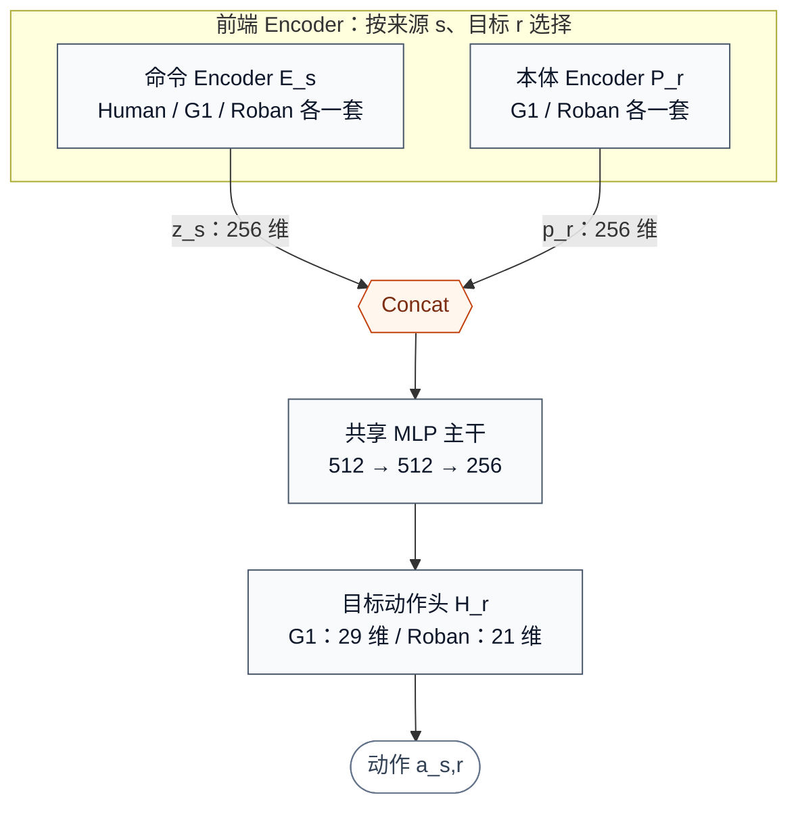

图按选中的来源 `s` 和执行机型 `r` 画一条路径：命令 Encoder 与本体 Encoder 在前端并排，经过 Concat 后进入共享主干和目标动作头。训练时可让同一状态经过多个来源分别前向；机器人每步仍只执行一个动作。

| 部件 | 可以怎样理解 | v0.2 的共享范围 |
|---|---|---|
| 命令 Encoder | 把某种格式的参考动作翻译成内部向量，也称 token | 三种来源各一套；同一来源 Encoder 供两个执行机型使用 |
| 本体 Encoder | 整理机器人当前状态与实际执行历史 | G1、Roban 各一套 |
| 共享主干 | 综合“想做什么”和“现在怎么样”，形成控制特征 | 两个机型、三个来源共用一套 |
| 动作头／解码器 | 把控制特征变成目标机型的动作 | 基础版为两个线性头；新解码器见第 5 节 |
| actor | 输出动作的整条网络路径 | 学生中由以上四类部件组成 |
| critic | 估计状态的后续回报，辅助强化学习 | 两机型各一套；不参与部署动作生成 |
| 标准差 | 决定强化学习采样动作时的探索幅度 | 与输出动作均值的网络参数分开管理 |

v0.2 学生使用 12 个参考时刻、9 个本体历史时刻和 8 个实际动作历史；参考窗口包含未来信息。**特权信息**指仿真中可获得的真实根状态、跟踪误差、关键点状态等额外信息：A 教师的 actor 可以看，普通学生 actor 不接收这些额外输入。

### 1.2 网络图的统一画法

图从前端 Encoder 开始，省略本体状态／动作历史输入层和环境执行层。除 A 教师外，命令 Encoder 与本体 Encoder 并排展示；`s` 表示命令来源，`r` 表示执行机型。本体 Encoder、目标动作头画的是当前机型对应的那一套。

| 形状／颜色 | 含义 |
|---|---|
| **矩形** | 网络或可学习参数模块，如 Encoder、MLP、动作头、Embedding |
| **圆角胶囊形** | 输入、特征、动作、标签等数据，不是网络 |
| **六边形，浅橙色** | Concat、FSQ、采样、积分等固定计算，本身没有可训练参数 |
| **菱形，浅黄色** | 损失项，只用于训练监督 |
| **绿色矩形** | 本阶段参与训练的网络 |
| **蓝色矩形** | 本阶段冻结的网络；仍可参加前向计算 |
| **灰白色矩形** | 仅第 1.1 节架构总览使用，暂不指定训练阶段 |
| **紫色边框** | 新建／替换结构或新增冻结副本；内部填色仍表示训练／冻结状态 |
| 实线箭头 | 网络前向与数据流 |
| 虚线箭头 | 输出、标签进入损失的监督关系 |

未启用的分支在正文和第 3 节总表说明，图中只保留当前计算路径。C 的冻结主干仍会把梯度传回新命令 Encoder；蓝色表示参数不更新。

## 2. 各类实验到底有几阶段

**A/B/C/D/E/U 是学习任务的名字，不是一条必须全部执行的流水线。** A 内部的两个教师并行训练，合起来算一个学习阶段。下面的阶段数按完整方法路线计；复用已有权重时，本组实际新跑的阶段更少。

| 实验类型 | 完整路线与阶段数 | 本组从哪里开始 | 主要变化 |
|---|---|---|---|
| 原分阶段方案 | **A→B→C，3 阶段** | 两教师和学生分别从随机初始化开始 | 先会控制，再学习 Human 共享控制，最后接通机器人来源 |
| PPO 微调 | **A→B→C→D，4 阶段** | 复用 C，只新做 D | D 内含 critic 预热、PPO 两个区段 |
| C 后教师纠偏 | **A→B→C→E，4 阶段** | 复用 C 与 A，只新做 E | 冻结来源／联合训练来源是两组独立 E 对照 |
| 去除 C 消融 | **A→B→E，3 阶段** | 复用已有 A、B，只新做直接 E | 跳过 C，六路直接向原生教师学习 |
| U-uniform | **A→U，2 阶段** | 复用 A，新建随机学生 | 从第一轮训练所有来源，均匀采样执行来源 |
| U-curriculum | **A→U，2 阶段** | 与 uniform 使用相同初始学生参数 | 早期多采 Human，随后转为均匀；训练模块相同 |
| Transformer 主干 | **A_T→B_T→E_T，计划 3 阶段** | 重训 Transformer 教师和随机学生 | 教师与学生的 actor 主干都替换；实际停在 B_T，E_T 未训练 |
| 命令 FSQ | **A→B_FSQ→E_FSQ，3 阶段** | 复用原 A，B/E 重新训练 | 三个命令 Encoder 尾部加入无参数量化模块 |
| 容量匹配 MLP 解码器 | **A→B_MLP→E_MLP，3 阶段** | 复用原 A，新建带 FSQ 的学生 | 线性动作头换成含机型条件的非线性解码器 |
| Flow Matching 解码器 | **A→B_FLOW→E_FLOW，3 阶段** | 复用原 A，新建带 FSQ 的学生 | 动作由同一个小解码器迭代 4 步产生 |

其中 `B_FSQ/E_FSQ`、`B_FLOW/E_FLOW`、`B_MLP/E_MLP` 用来方便阅读；它们复用 B/E 训练协议，结构由配置、checkpoint 构造信息及运行目录区分。

各阶段的承接关系可以这样读：

```text
A：训练两位原生教师 ── 提供冻结监督 ──┬── B：新建 Human 学生
                                     │       ├── C：接通机器人来源
                                     │       │       ├── D：PPO 微调
                                     │       │       └── E：教师纠偏
                                     │       └── E：直接六路纠偏，跳过 C
                                     └── U：新建学生，六路一起学习

Transformer：另训 A_T 教师，再新建 B_T 学生；通过后才进入 E_T。
FSQ / 新 MLP 解码器 / FLOW：复用原 A，分别新建 B 学生，再进入各自 E。
```

**D 与 E 都从 C 出发；当前教师纠偏实验没有把 D 权重传给 E。** A→B 传递的是教师监督能力，学生不复制 A 的网络层。

## 3. 学生网络的训练／冻结总表

“执行模块”在本文统一指：**两个本体 Encoder＋共享主干＋动作头／解码器**。A 是独立教师网络，不在此表中；A 自己的 actor、critic、标准差均参与 PPO 训练。

| 学生阶段 | Human 命令 Encoder | G1/Roban 命令 Encoder | 本体 Encoder | 主干＋动作输出 | critic | 标准差 |
|---|---|---|---|---|---|---|
| B | **训练** | 冻结，未用 | **训练** | **训练** | 冻结，未用 | 冻结，未用 |
| C | 冻结，作参照 | **训练** | 冻结 | 冻结 | 冻结，未用 | 冻结，未用 |
| D：前 100 轮 | 冻结 | 冻结 | 不更新 | 不更新 | **训练** | 固定 0.1 |
| D：后 500 轮 | 冻结 | 冻结 | **训练** | **训练** | **训练** | 固定 0.1 |
| E：冻结来源组 | 冻结 | 冻结 | **训练** | **训练** | 冻结，未用 | 冻结，未用 |
| E：联合来源组／直接 E | **训练** | **训练** | **训练** | **训练** | 冻结，未用 | 冻结，未用 |
| U：两组相同 | **训练** | **训练** | **训练** | **训练** | 冻结，未用 | 冻结，未用 |

Transformer、FSQ、新 MLP 解码器和 FLOW 的 B/E，沿用表中的 **B 与直接 E** 范围；FLOW 改变教师监督目标，见第 5.3 节。所有作为标签来源的 A 教师、所有固定保持模型，均冻结。

## 4. 每个学习阶段具体做什么

### 4.1 A：先训练两个能独立控制本机型的教师

目标是让 G1 教师会跟踪 G1 原生参考，让 Roban 教师会跟踪 Roban 原生参考。两套网络、优化器相互独立，使用环境奖励进行 PPO 训练。

下图画一位教师，`r` 分别取 G1、Roban；另一位结构相同、参数独立。原生教师直接把原生参考、本体及特权信息拼接进 actor MLP，没有学生式的独立本体 Encoder。

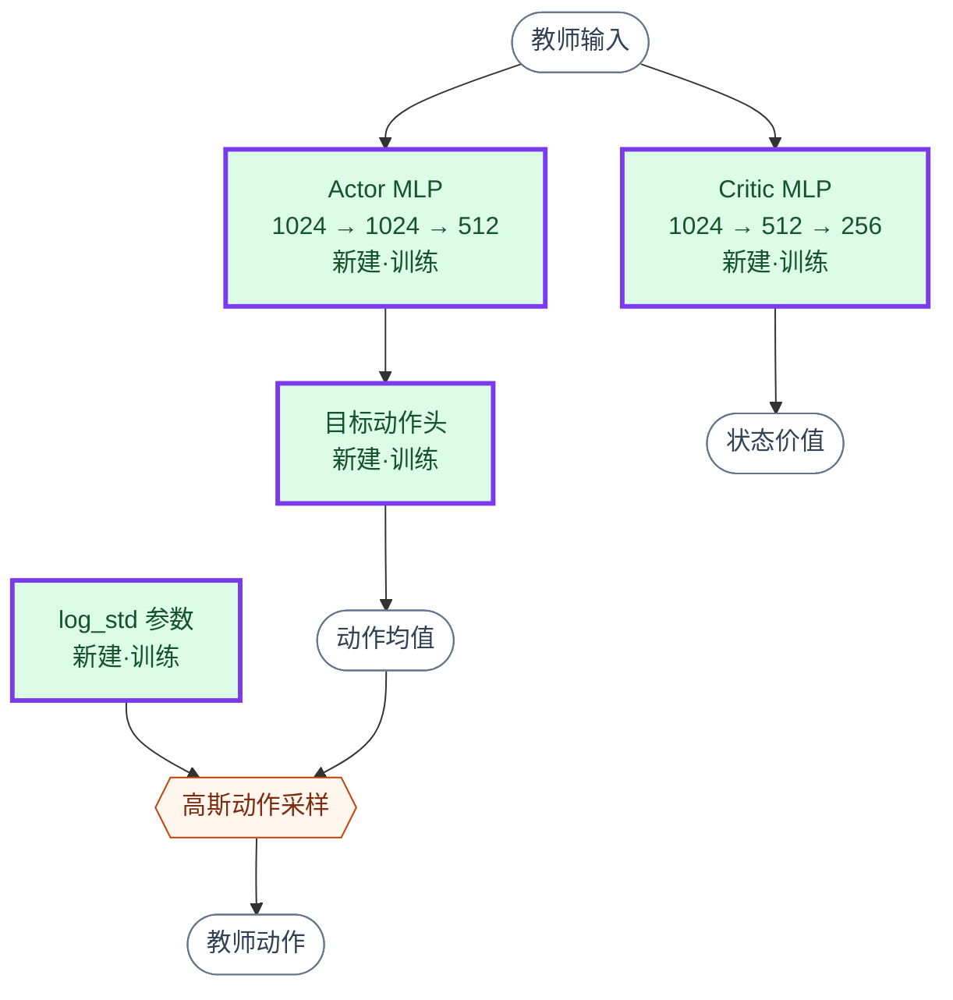

**新增：两套完整教师。** 此时还没有共享学生，也不做跨来源对齐。后续查询哪位教师，由**执行机型**决定：即使学生输入 Roban 命令，只要实际控制 G1，标签仍由 G1 教师给出。

### 4.2 B：新建共享学生，只开 Human 入口

B 学习“同一个 Human 动作要求，怎样分别让 G1 和 Roban 执行”。**新建一套完整学生**，从随机参数开始；先训练 Human 命令 Encoder 和执行模块。

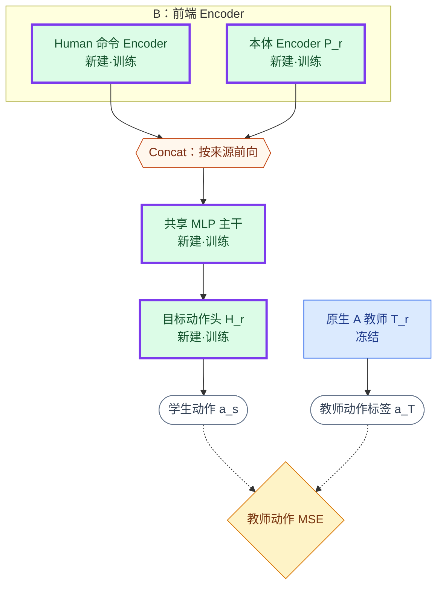

先让教师多执行，随后减少接管，在实际遇到的状态上持续查询教师、保存样本并监督学习。这就是这里 DAgger 的用途：学生偏离理想轨迹后，也能得到该状态下的纠正动作。标签是教师的**控制动作均值**，数据中的参考关节角用作参考，不直接充当学生动作标签。

**训练方式：动作模仿，没有 PPO。** A 教师不更新；学生不读取教师特权输入。B 最终只验收 `Human→G1/Roban` 两路，机器人来源 Encoder 冻结且未启用。

### 4.3 C：控制能力固定，只学习两个新命令入口

C 从 B 权重开始，目标是把 G1、Roban 参考也翻译成已会控制的学生能够理解的命令向量。

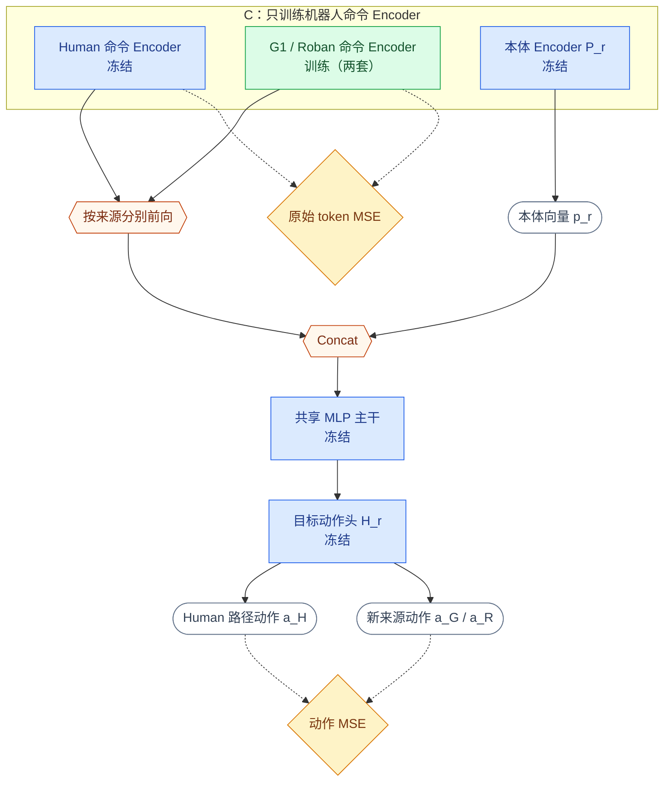

Human、G1、Roban 的命令向量**分别**与同一个本体向量拼接，复用同一套冻结主干和动作头，得到各自的动作；三来源向量不一起拼接。Human 路径作为固定参照，token 与动作两项损失最终只更新两个机器人命令 Encoder，包括它们各自的归一化参数。

**新增的是可用入口，网络结构没有新增。** G1/Roban 命令 Encoder 在 B 建模时就存在，C 首次训练它们。C 不再查询 A 教师，不做 PPO；完成后评估三来源×两执行机型，共六路。

### 4.4 D：从 C 出发，用奖励微调控制能力

D 保留 C 学到的三个命令入口，冻结它们；首次启用学生 critic 的学习，再用 PPO 更新执行模块。

| D 内部区段 | 训练什么 | 动作网络的变化 |
|---|---|---|
| 第 1～100 轮：critic 预热 | 只训练两机型 critic | actor 的动作均值参数不变；训练采样标准差设为 0.1 |
| 第 101～600 轮：PPO | critic＋本体 Encoder＋主干＋动作头 | 来源编码器继续冻结，标准差继续固定 |

下图表示后面的 PPO 区段：

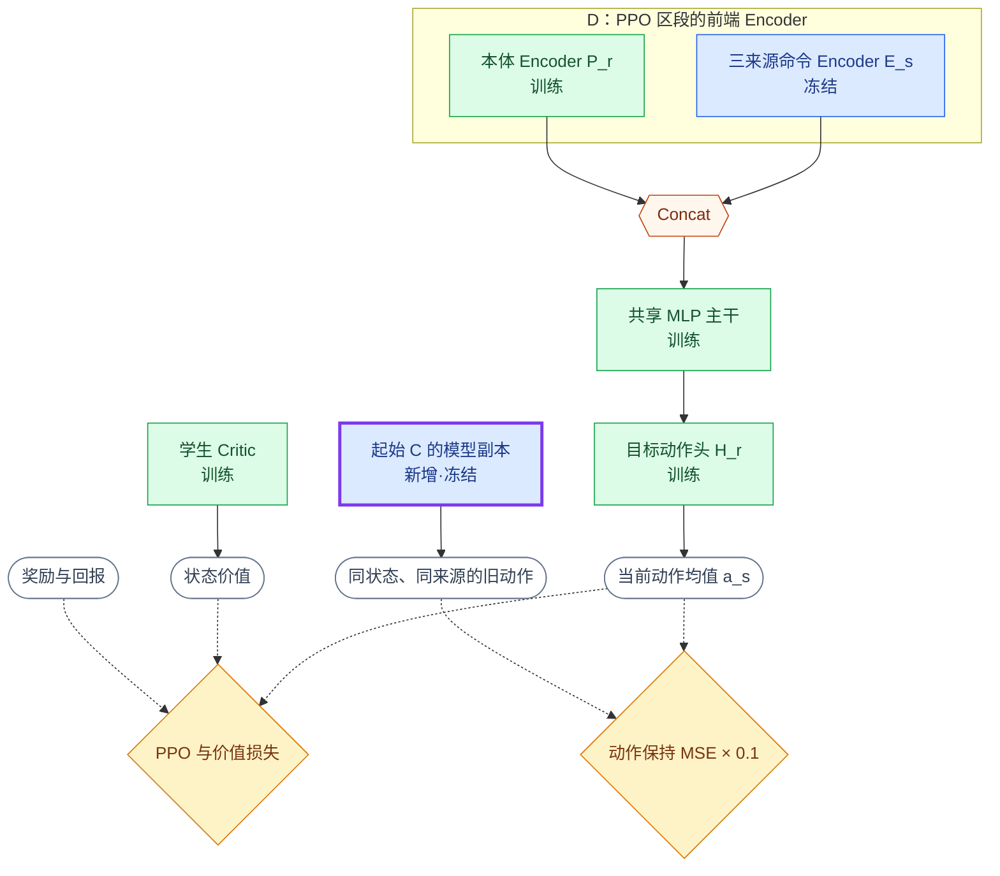

**没有新增可训练网络层。** critic 在 B/C 已存在但一直冻结，D 首次训练它；另外复制一份冻结 C，限制当前动作偏离起点。D 不查询 A 教师动作，也不使用 B/C 的监督回放缓冲。原 D 实验完成后质量退化，结果见[阶段 D 分析](../科研/v0.2/02_PPO微调_D阶段负结果.md)。

### 4.5 E：回到原生教师，纠正六路学生动作

E 使用纯学生执行产生状态，再让对应目标机型的冻结 A 教师标注。对于**同一个实际状态**，Human/G1/Roban 三条输入路径都向该教师动作学习。先画联合来源组和直接 E，所有学生 actor 模块均为绿色：

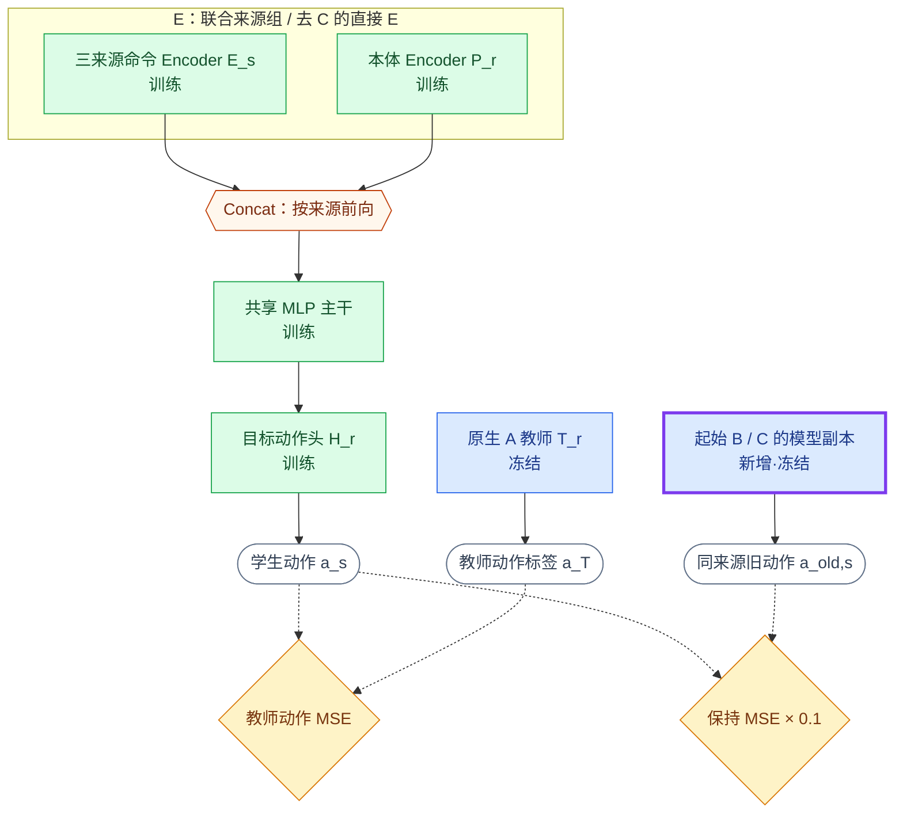

冻结来源对照组的网络如下；教师监督和起始 C 保持项与上图相同，来源 Encoder 改为冻结。

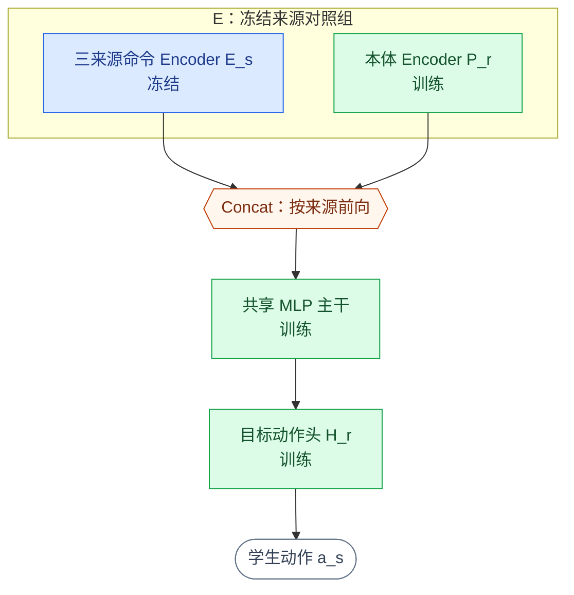

| E 的具体实验 | 起始学生 | 三个来源编码器 | 固定保持模型 | 正式训练量 |
|---|---|---|---|---|
| C 后冻结来源纠偏 | C | 全冻结 | 起始 C 的副本 | 300 轮 |
| C 后联合来源纠偏 | 同一个 C | 全训练 | 起始 C 的副本 | 300 轮 |
| 去 C 的直接 E | B | 全训练 | 起始 B 的副本 | 2300 轮 |

前两组用于比较“纠偏时要不要一起修改命令表示”。直接 E 则跳过 C：B 中未学过的机器人来源编码器，在 E 首次学习，同时继续调整 Human 入口和执行模块。

普通 MLP 的 E 目标是：**教师动作误差＋0.1×起始学生动作误差**。固定副本只提供参照，本身不学习；学生动作、教师动作和旧学生动作都在同一个目标机型的动作空间中比较。误差先按有效动作维度求平均，再对三来源、两机型等权平均。

**E 没有 PPO，也没有教师接管。** 直接 E 的前 2000 轮和后 300 轮仅改变优化次数与 batch，用于匹配原 C＋E 预算；两个区段始终使用同一个 E 目标，分界处保留模型、优化器和回放缓冲的状态。细节见[教师纠偏](../科研/v0.2/03_教师纠偏_C到E.md)、[去 C 消融](../科研/v0.2/04_去除C_A到B到E.md)。

### 4.6 U：从随机学生开始，六路一起学

U 将 B 的 Human 学习与后续六路学习合并。从第一轮开始，三个命令 Encoder 和整个执行模块都训练；不加载 B/C/E 学生权重。

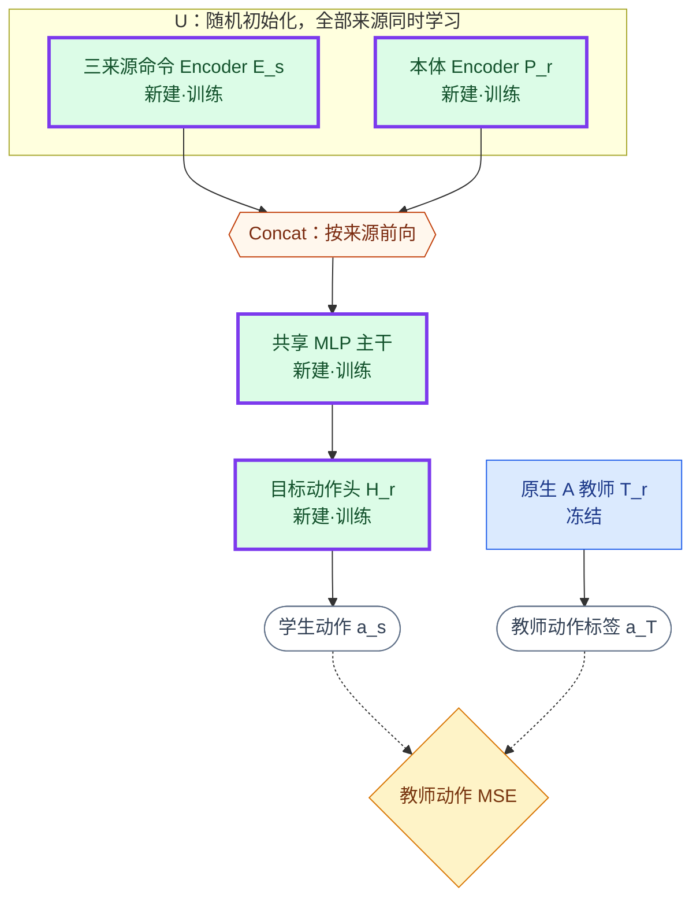

| U 组别 | 哪个来源负责实际执行 | 哪些来源接受监督 |
|---|---|---|
| uniform | 三来源目标比例始终各 1/3 | 从第一轮就三来源等权 |
| curriculum | 前 500 轮为 0.6/0.2/0.2，随后 1000 轮转为各 1/3 | 同样从第一轮就三来源等权 |

两组都使用相同的早期教师接管，随后退至零。课程只改变**访问状态由哪些来源的动作产生**，没有把某个编码器先冻结再解冻。全程不做 PPO，不设固定旧学生副本。

**4300 轮始终是一个 U 学习阶段。** 最后 300 轮的优化频率变化用于匹配预算，不代表切换成 E。详见[U 阶段实验](../科研/v0.2/05_联合训练_U与来源课程.md)。

## 5. 网络结构变体：在哪个阶段加入什么

这些实验仍使用前面的阶段职责。需要额外关注的是：**替换发生在学生创建时，还是连教师也一起重训。**

### 5.1 Transformer：教师和学生的 actor 主干都替换

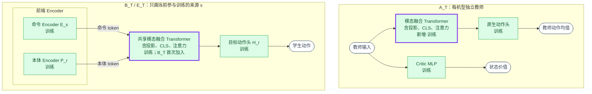

图中学生只画参与训练的来源 `s`：B_T 中 `s=Human`，G1/Roban 命令 Encoder 冻结且不启用；E_T 的设计则对三个来源分别前向并训练。共享 Transformer 在 **B_T 建立时就加入**，E_T 计划继续使用同一套结构；后文注明 E_T 实际未训练。

这里的 token 是整段历史编码后的**模态向量**：教师 3 类输入＋CLS，学生 2 类输入＋CLS；没有把每个历史时刻拆成时间序列。由于 A_T 也换了结构，整条路线的差异包含教师与学生两方面。

**实际完成 A_T、B_T 后，B_T 完整验证未通过，E_T 未训练。** 见[Transformer 完整实验与失败分析](../科研/v0.2/06_Transformer主干_完整实验与失败分析.md)。

### 5.2 FSQ：只在命令 Encoder 尾部加量化

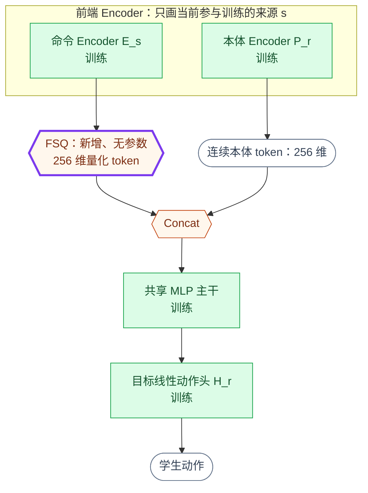

图中只画参与训练的来源 `s`：B_FSQ 为 Human，E_FSQ 为三个来源分别前向。三个来源的命令 Encoder 在 **B_FSQ 创建学生时就全部带 FSQ**；B 中 G1/Roban 分支冻结且不启用。FSQ 是六边形固定计算，没有可训练参数；反向传播采用平滑分支的梯度，命令 Encoder 仍能学习。

复用已有 A 教师，学生 B/E 从头重训；不把已有连续 B/E 权重直接改成量化模型。机器人本体 Encoder 保持连续，主干与线性动作头结构保持基础版形式；本路线不做 C 的 token 对齐。见[FSQ 实验](../科研/v0.2/07_FSQ命令表征_当前主基线.md)。

### 5.3 新 MLP 与 FLOW：在 FSQ 学生上换动作解码器

两组均复用原 A，分别**从 B 新建学生**。命令 Encoder 带 FSQ，本体 Encoder 和共享 MLP 保持原结构；改变的是主干后面的动作输出模块。没有从已训练的 FSQ E 权重接着微调。

容量匹配 MLP 的动作解码网络：

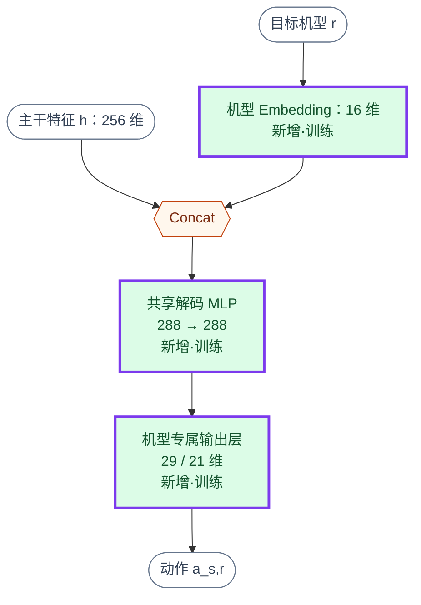

FLOW 的动作解码网络（画实际执行的零初值路径）：

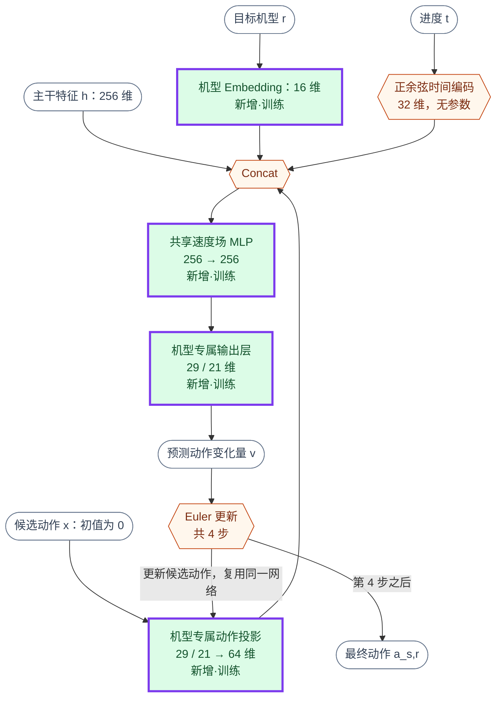

机型嵌入是一小段可学习的机型提示。两种新解码器的中间网络跨机型共享，输出层区分 G1/Roban；FLOW 的候选动作输入投影也按机型区分。其解码器参数量与新 MLP 相差不足 1%，比较对象是同等容量的一次回归与迭代解码。

| 阶段 | 新 MLP | FLOW |
|---|---|---|
| B | Human 入口＋执行模块＋新解码器，拟合教师动作 | 同样的模块范围，学习朝教师动作移动的“变化量” |
| E | 三来源＋执行模块＋解码器，教师动作误差＋0.1×冻结起始 B 保持项 | 同样的模块范围，流匹配误差＋0.1×最终动作对冻结起始 B 的保持项 |

FLOW 训练时，先把高斯噪声与教师动作按随机进度混合，得到候选动作：`候选 = (1−t)×噪声 + t×教师动作`。网络看到候选、进度、控制特征和机型，学习的目标变化量是 `教师动作−噪声`。教师动作只参与训练目标构造。

实际执行与主评估都从**零动作初值**出发，固定 4 步 Euler 更新；不把训练高斯噪声作为逐帧执行输入。编码器和主干每控制周期算一次，小解码器重复 4 次，随后才向环境施加一次动作；它没有一次输出未来多帧动作。

**新解码器在 B 就加入，E 不再新增网络。** B/E 的 critic、标准差、A 教师及 E 的起始 B 副本都冻结。FLOW 的教师项作用于变化量，保持项作用于积分后的动作，两项不能套用普通 E 的动作加权平均解释。见[Flow Matching 与容量匹配 MLP 实验](../科研/v0.2/08_FlowMatching与MLP动作解码.md)。

## 6. 与 v0.1、v0.3 的阅读对照

### 6.1 v0.1：一段联合 PPO，没有 A/B/C 教师链

从随机策略开始，三个来源编码器、本体 Encoder、主干、动作头、critic 和标准差一起训练。环境奖励驱动 PPO，共享版还加入三来源命令向量对齐。

| v0.1 类型 | 网络差别 | 学习阶段数 |
|---|---|---|
| `shared` | 来源编码器和主干跨执行机型共享，带 token 对齐 | 1 |
| `no_align` | 保留共享结构，去掉 token 对齐 | 1 |
| `independent` | 两机型各自拥有来源编码器与主干，保留对齐 | 1 |

数据准备、训练、评估是工作流程的三个步骤；按本笔记“参数如何学习”的口径，它们只有**一段策略训练**。见[v0.1 正式实验说明](xwbc正式实验.md)。

### 6.2 v0.3：关节共享网络，一段联合 PPO

v0.3 主方案不依赖 A 教师。它从随机初始化开始，把共享单位改为关节，并把固定的关节结构、物理与控制属性作为输入。

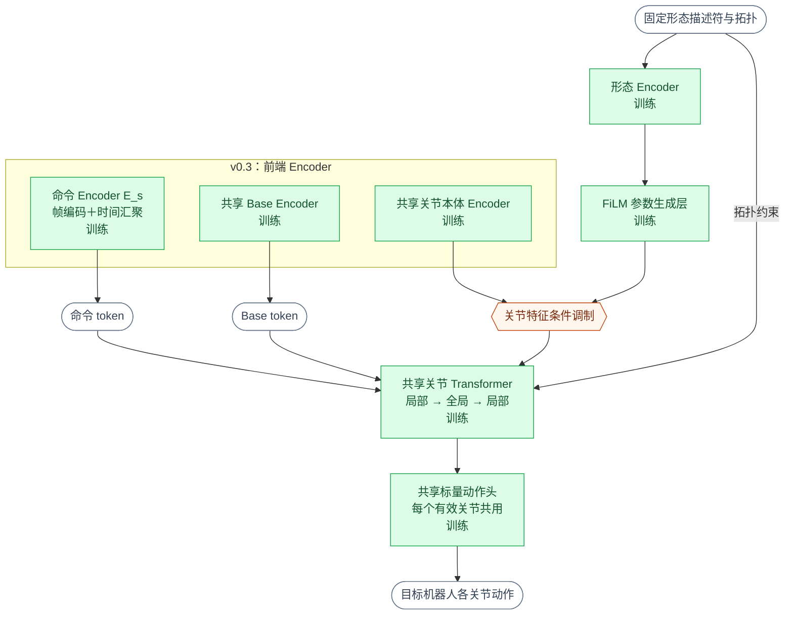

整个 actor、两机型 critic 和产生探索标准差的网络一同训练，没有固定 Human 教师或分阶段解冻。主方案同时使用奖励、命令向量对齐，以及**同一状态三来源动作之间的一致性约束**；动作一致性权重在前 500 轮逐渐升高，仍属于同一个联合训练阶段。

`mlp_matched`、`no_consistency`、`morph` 等是**分别从头训练的对照组**，不是前一组训练完再接下一组。v0.2 的 Transformer 是整机模态融合，v0.3 主方案则让关节之间交换信息，二者的结构与学习路线都有区别。详见[v0.3 研究方案](../../HEFT_XWBC_v0.3/科研/v0.3/01_研究方案与实验依据.md)与[实验矩阵](../../HEFT_XWBC_v0.3/科研/v0.3/02_实验矩阵与判定标准.md)。

## 7. 阅读实验记录时的四个定位点

1. **初始化来源。** 新建随机学生、加载 B/C 权重开始新阶段、恢复优化器继续同一阶段，分别说明了不同的学习起点。
2. **实际执行者。** B/U 早期可能由教师接管，C 早期可能由 Human 路径接管，E 全程由学生执行；最终独立评估没有教师接管。
3. **学习目标。** A/D 是奖励驱动，B/E/U 查询原生教师，C 对齐固定 Human 路径；FLOW 还改变了教师目标的表达形式。
4. **结构与参数变化。** B 新建完整学生；C 训练已有入口；D 启用已有 critic；E 增加冻结参照副本；FSQ/新解码器在各自 B 创建学生时接入。

这里的图说明网络与信息流，不用训练误差代替闭环能力。阶段完成、验证通过、整条路线完成是不同状态；Transformer 停在 B_T 的例子尤其需要区分。

核对实现时，可从以下入口直接定位：

| 要核对的内容 | 代码／文档入口 |
|---|---|
| 基础学生结构、FSQ 接入位置、动作解码器替换位置 | [XWBCPolicy](../active_adaptation/learning/modules/xwbc.py) |
| 教师结构、B/C 可训练模块、C 两项损失 | [分阶段模型](../active_adaptation/learning/modules/xwbc_staged.py) |
| B/C 实际采集、同状态标签与教师接管 | [分阶段训练](../active_adaptation/learning/xwbc_staged.py) |
| D 预热与 PPO 的更新范围 | [PPO 微调](../active_adaptation/learning/xwbc_finetune.py) |
| E 来源冻结开关、六路监督、固定保持模型 | [教师纠偏入口](../scripts/refine_xwbc_student.py) |
| U 随机初始化、来源课程与接管 | [U 训练入口](../scripts/train_xwbc_unified.py) |
| 新 MLP、流目标与 4 步动作生成 | [动作解码器](../active_adaptation/learning/modules/xwbc_action_decoder.py) |
| 运行命令、阶段准入与恢复操作 | [v0.2 分阶段训练说明](xwbc_v0.2分阶段训练.md) |
