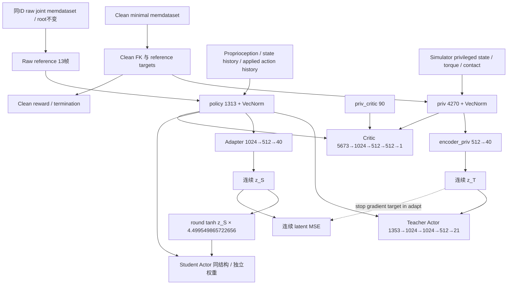

# 03 Teacher–Student 网络与信息流

## 主方案：复用当前HEFT

以上维度由当前checkpoint核验；图中clean/raw paired机制已存在，v0.1要新增的是Roban污染数据和协议，不是新Actor。VecNorm对各组处理，Teacher/Student共享policy normalized输入；Student部署图只保留policy→Adapter→Q→Student Actor及policy直连。

## 输入边界

| 信息 | Teacher Actor直接 | Teacher encoder | Student/Adapter部署 | Critic/reward |
|---|---|---|---|---|
| raw joint reference13帧，root reference | policy中 | 不要求新增raw输入 | 允许 | 允许 |
| q/dq/gyro/gravity history、applied actions | policy中 | 既有无噪state priv也可用 | 允许部署可得版本 | 允许 |
| clean joint/clean FK目标、最多+20帧 | 只能经z_T | 允许 | 禁止 | 允许 |
| simulator root velocity、body states、torque/contact | 只能经z_T | 既有字段允许 | 禁止新增 | 允许 |
| domain motor/material/offset/gravity | 不直接 | 当前不在priv encoder输入 | 禁止 | 仅priv_critic |
| corruption seed/type/mask/severity、clean−raw residual | 不新增 | 第一版不新增 | 禁止 | 仅日志，不进入Actor |

Teacher不需要新增维度：policy已取student horizon/raw `_motion_student`，priv已取teacher horizon/clean `_motion`；加载paired即可实现“Actor脏输入+clean privileged guidance”。Student也无需新增输入：现有policy既有raw参考、误差特征和反馈history。保持40维latent，不增加重建头，不将clean q拼到部署Actor。

不能假定Adapter总能从raw恢复clean：例如真实意图offset与错误offset可能不可辨识。latent中的simulator信息也未必完全可观测。实验须报告不可辨识边界，而非用更大latent掩盖信息不足。

## 连续对齐与实际控制差异

Stage2 `Lz=mean((z_S-stopgrad(z_T))² * ~is_init)`；与源码同mask/reduction，额外诊断用valid-count归一化另命名。当前MSE未经过quantizer。必须记录：

- 连续Lz、逐维z_T/z_S variance、均值、分位数与协方差有效秩；防止共同塌缩造成低loss。
- Q(z_S)与z_T距离、量化level占用、饱和比例、Q(z_S)与Q(z_T)差异（后者仅诊断）。
- 在同一个已保存state/raw input上 `A_T(o,z_T)` 与 `A_T(o,Q(z_S))` 的mean-action差，隔离representation替换；另测 `A_S(o,Q(z_S))` 区分Finetune Actor变化。
- 分别真实rollout T/A/F，而不是仅离线action相似度。动作差先报raw action，再乘Roban scale报motor target角差，最后检查滤波后的实际控制。

不在第一轮修改quantizer/latent loss。若adapt失败且量化差异主导，在validation证据明确后另建量化一致性消融，并冻结独立合同；不能把该改动混进原F结果。

## N-raw 与 N-direct 对照的最小网络变化

N-raw保持encoder4270及Actor1353形状，引入独立`encoder_priv_obs`同shape raw-derived privileged观测；critic仍看原clean priv。raw horizon需覆盖原Teacher offsets，不能用13帧Student窗口冒充12帧Teacher窗口或偷取clean future。目标keypoints、contact以及body-z/gravity hints（含raw独立计数）全部由raw reference重算，actual simulator fields可保留。真实termination及reward仍按clean，raw hint计算不得更改环境termination buffer。所有同名维度及symmetry排列保持一致；normalizer须独立记录encoder输入统计。

N-direct不运行encoder_priv/Teacher监督，只走可部署Student链，critic仍可用clean priv。为避免人为弱化，新增显式joint-PPO开关更新Adapter+Actor；现有Finetune `no_grad`与opt_student仅Actor必须同时调整。量化器已有STE可复用；禁止只改requires_grad却忘记optimizer/DDP，测试单步参数hash确认更新。

## 信息隔离测试（实现阶段）

固定policy1313后任意改变clean/priv/priv_critic，Student action须逐元素一致；Teacher可变化。打乱corruption metadata也不能改变action。导出ONNX只能输入policy且图中无encoder_priv、critic或clean；训练Student rollout也不得调用Teacher结果替换action。

检查reset、boot protect、history填充是否从clean派生并持续注入控制。主实验reset可共享clean初态，但关闭clean boot actuator override；部署验证从共同站姿/AMP切换独立报告。Teacher target computation需no_grad，Stage2其他模块与VecNorm hash不变；Stage3 Adapter hash不变。测试包括对称增强、DDP与normalization，不能只在裸MLP测试。
