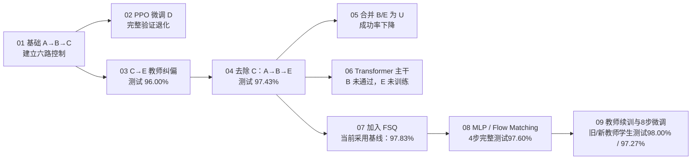
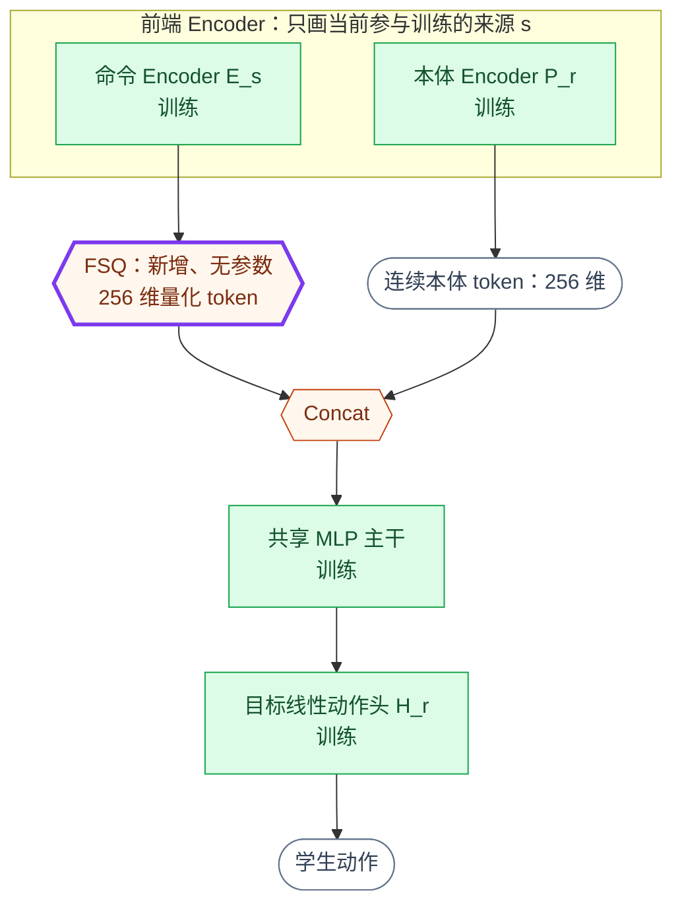

# v0.2 研究总览：从分阶段蒸馏到可复用的跨机型控制

**当前方向：沿用 A→B→E，以 FSQ 命令表征作为后续实验的主基线，研究动作解码方式是否能进一步改善 G1 / Roban 的跟踪。** FSQ 的完整测试成功率为 **97.83%**；选择它作为主线是研究决策，其相对连续表征的测试收益尚未获得明确统计支持。

**最新完成：教师续训与8步FM增量对照。** 两位A15000教师的精度明确改善，但新教师未带来明确的学生整体收益：旧/新教师微调1000轮的测试成功率为 **98.00% / 97.27%**，根相对误差为 **6.25 / 6.13cm**。保留旧教师微调版本为候选，暂不替换FSQ主基线；详见[完整增量实验](09_教师续训与8步FM增量微调.md)。

## 1. 先看研究链路

箭头表示研究问题如何产生，不都表示权重传递。例如 FSQ 和新解码器复用 A 教师，但各自重训 B/E；D 的权重没有用于 E。

| 一篇笔记对应一个实验问题 | 主要对照与发现 | 当前用途 |
|---|---|---|
| [01 基础路线：A→B→C](01_基础路线_A到B到C.md) | A 先会控制，B 学 Human 两路，C 接通机器人来源；C 验证成功率93.50% | 解释阶段职责和共享结构 |
| [02 PPO 微调：D 的负结果](02_PPO微调_D阶段负结果.md) | 从同一 C 微调，验证93.50%→81.37% | 保留失败证据，避免把奖励优化视作必然收益 |
| [03 教师纠偏：C→E](03_教师纠偏_C到E.md) | 同一 C 的冻结来源 / 联合来源两组；选定联合来源 E300，测试96.00% | 确立六路原生教师动作监督 |
| [04 去除 C：直接 A→B→E](04_去除C_A到B到E.md) | 匹配 C＋E 后续预算，测试96.00%→97.43% | 确立当前训练范式；连续表征对照 |
| [05 联合训练：U 与来源课程](05_联合训练_U与来源课程.md) | uniform / curriculum 测试96.50% / 96.03%，均低于97.43% | 分阶段仍是首选；课程不等于损失重加权 |
| [06 Transformer：完整实验与失败分析](06_Transformer主干_完整实验与失败分析.md) | A_T完成，B_T验证平均仅56.60%，未进入E_T | 负结果；不推广到所有Transformer |
| [07 FSQ：当前主基线](07_FSQ命令表征_当前主基线.md) | 测试97.43%→97.83%，验证略降，测试差异区间跨零 | 后续开发默认起点，连续版继续保留 |
| [08 Flow Matching 与容量匹配 MLP](08_FlowMatching与MLP动作解码.md) | 固定A和FSQ，4步FM测试97.60%，8步验证有积极信号 | 已完成，未替换FSQ主基线 |
| [09 教师续训与8步FM增量微调](09_教师续训与8步FM增量微调.md) | 教师精度提升；旧/新教师学生测试98.00% / 97.27%，未确立新教师整体收益 | 已完成，旧教师微调版保留为候选 |

同一问题的多组对照放在一篇中；方案、训练与最终结果也在同一篇持续更新。已经结束的实验不再以“已启动、待验证”开篇。

## 2. 当前网络到底长什么样

以 `Roban→G1` 为例：**Roban 命令编码器＋FSQ、G1 本体编码器、共享 MLP、G1 动作头**。命令来源与执行机型是两个独立维度。FM/MLP只替换图中的动作头，结构详见第08篇。

| 模块 / 输入 | 当前 FSQ 主基线 |
|---|---|
| 命令窗口 | 50Hz；偏移 `[0,1,2,4,8,12,16,20,-1,-2,-4,-8]`，包含未来400ms；Human/G1/Roban输入为3204/1908/1908维 |
| 来源编码器 | 每来源一套；LayerNorm→Linear512→ELU→Linear256→ELU→FSQ；同一来源供两执行机型使用 |
| FSQ | `round(4.499549865722656*tanh(z))`，反向用平滑分支；保留末层ELU，实际可达整数−3…4；无可训练参数 |
| 本体历史 | 9个状态时刻 `[0,1,2,3,4,8,12,16,20]`＋8个实际动作；G1/Roban输入808/600维 |
| 本体编码器 | 每机型一套，512→256，连续输出 |
| 共享主干 | 两个256维向量拼接，MLP 512→512→256，六路共用 |
| 动作输出 | 机型专属线性头，G1 29维、Roban 21维；每20ms执行一次 |
| 部署信息 | 命令与本体历史；A教师看到的额外特权状态不直接提供给学生 |

图的统一约定：绿色网络参与本阶段训练，蓝色网络冻结，紫色边框表示新增/替换；矩形为网络、胶囊为数据、六边形为无参数运算、菱形为损失。冻结参数的模块仍可向其输入传递梯度。更完整的逐阶段解释见[训练阶段与网络图解](../../docs/xwbc各类实验_训练阶段与网络图解.md)。

## 3. 当前训练范式一页读懂

| 阶段 | 学什么 / 谁执行 | 训练与冻结 | 核心预算 |
|---|---|---|---|
| A | 两独立原生教师，以PPO学本机型跟踪 | 各自actor、critic、标准差训练 | 每机型4096环境×32步×10000轮 |
| B | 新学生先学Human→两机型；教师接管逐步退出，监督始终保留 | Human编码器＋本体编码器＋主干＋动作头训练；机器人来源编码器及critic/标准差冻结 | 每机型1024环境×16步×2000轮；32次优化/轮、batch2048/机型，lr=1e-4 |
| E | 学生独立执行；同状态三来源均向对应原生教师学习 | 所有actor模块训练；A、critic、标准差及起始B副本冻结 | 2300轮；前2000轮32×2048、后300轮16×1024，lr=1e-5 |

普通 E 损失为“教师动作MSE＋0.1×冻结起始B同来源动作MSE”。FLOW只改教师项为向量场MSE，保持项仍作用于积分后的实际动作。

B＋E 每组共 **140,902,400 transitions、132,800次优化、534,118,400次回放状态抽样**；每机型reservoir容量32768，保留累计历史的均匀样本。上述预算相同不代表FLOPs、教师标签路由数或墙钟相同。

## 4. 所有结果遵循的阅读口径

- 数据为 `dataset/xwbc/simple_5k_v02`：4000/500/500动作，656/83/93家族；按家族隔离。验证/测试主要覆盖走路、跑步、上身，浅蹲只有8条训练动作，不能宣称已评估蹲起泛化。
- A 每教师评500条；B只评Human两路，共1000条；C/E/U评六路，共3000条。**不能把B两路均值与E六路均值当成同口径性能排名。**
- 验证通常64环境，测试500环境，seed42；模型比较必须在相同划分、动作集合和环境设置下进行。
- 本目录误差统一用 **cm**。各路误差按有效步数加权，再跨路等权；失败前有效步仍计入。成功率差用“百分点”，不与相对百分比混用。
- 家族配对95%区间保留同家族及多路记录的关联；多数比较用10000次重采样。区间不覆盖训练种子方差；跨零不等于已经证明等效。
- 原生教师和B曾按用户目标调整准入规则，原评分与原判定均保留。当前B能力准入为成功≥90%、完成≥95%、根相对误差≤10cm、恢复片段≤1%，世界误差作诊断。
- `result.json`表示训练结束，`pipeline_result.json`才表示对应队列工作完成；测试gate里的`full_validation_required`不等于测试模型失败。
- 当前实验均为单训练种子、已见G1/Roban、离线配对参考、无负载/外部扰动的仿真研究。后续测试集已被此前实验查看，不作为新的未触碰留出集。

## 5. 如何查证与接续

每篇末尾集中给出配置、运行目录、权重、评分和审计入口。复现从项目根目录执行，使用全新输出目录。Checkpoint恢复学习器状态后会重开仿真回合，不等于逐位续跑保存瞬间的物理状态。

- [稳定训练操作说明](../../docs/xwbc_v0.2分阶段训练.md)：命令、数据、恢复和阶段准入。
- [图解索引](../../docs/xwbc各类实验_训练阶段与网络图解.md)：跨v0.1/v0.2/v0.3的结构与冻结范围。
- [旧记录如何合并](#旧记录如何合并)：原18份笔记直接合并，不保留重复旧稿。日志中的旧报告路径可按下表定位。
- [原有图表来源清单](analysis/archive_manifest.json)：保留PNG及Transformer第5600轮分析附件。

后续更新先改对应实验笔记的开篇状态与结论，再补结果和证据，最后更新本页。当前主线选择与统计优越性分开表述；没有最终结果的实验保留明确时间快照，不提前替换主基线。

## 旧记录如何合并

| 原记录编号 | 现行笔记 | 整理方式 |
|---|---|---|
| 01–05 | [基础A→B→C](01_基础路线_A到B到C.md) | 合并方案、A/B/C运行及B监督机制，补齐完整结果 |
| 06–07 | [PPO微调D](02_PPO微调_D阶段负结果.md) | 先呈现退化结论，再解释结构、训练与诊断 |
| 08–09 | [C→E教师纠偏](03_教师纠偏_C到E.md) | 合并两组探索、选择规则与完整评测 |
| 10–11 | [去除C](04_去除C_A到B到E.md) | 固定终点方案和最终结论合一 |
| 12–13 | [U与来源课程](05_联合训练_U与来源课程.md) | 两组设计、完整结果与回放诊断合一 |
| 14–16 | [Transformer](06_Transformer主干_完整实验与失败分析.md) | 5600轮快照降为过程证据，突出B失败与E未执行 |
| 17 | [FSQ](07_FSQ命令表征_当前主基线.md) | 补充当前采用决策，保留统计证据的限制 |
| 18 | [FM/MLP解码](08_FlowMatching与MLP动作解码.md) | 合并设计、实现、B结果与E进度，后续在同篇续写 |

不改动训练代码、配置、checkpoint或运行中的队列。图表、原始评分、配置快照、启动/审计记录仍在原位置；历史JSON中指向旧笔记名的文字属于当时记录，不改写历史日志。文档外部入口已同步迁移。[重构证据与映射](analysis/restructure_20261007/summary.json)记录原文件摘要和评分来源。
