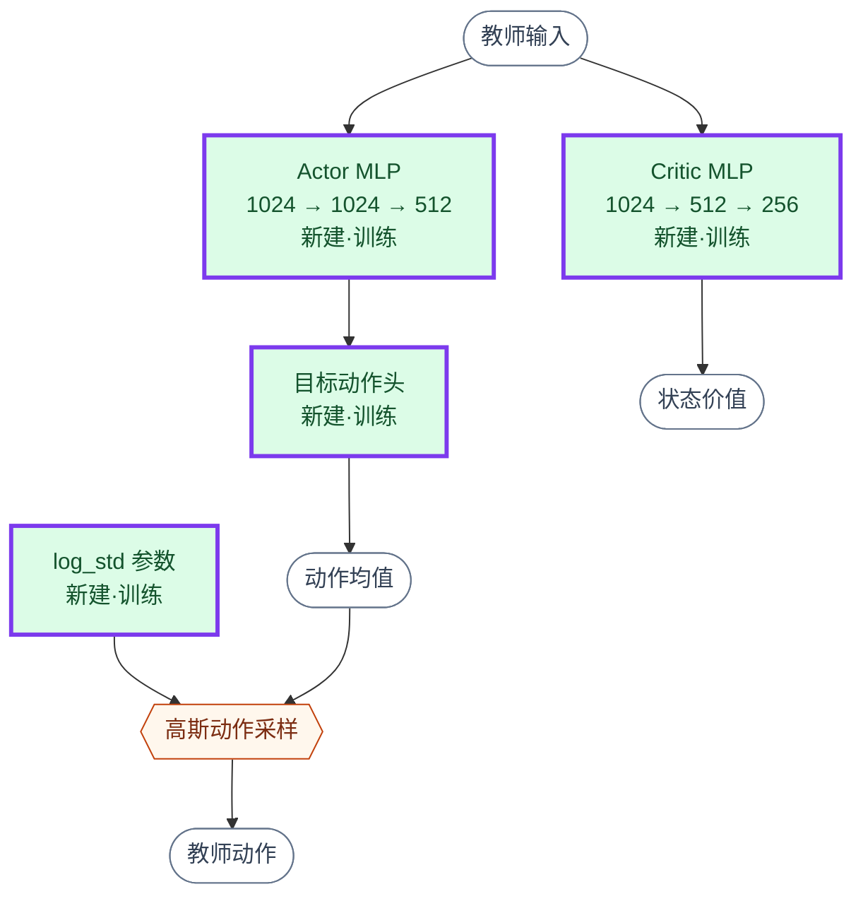
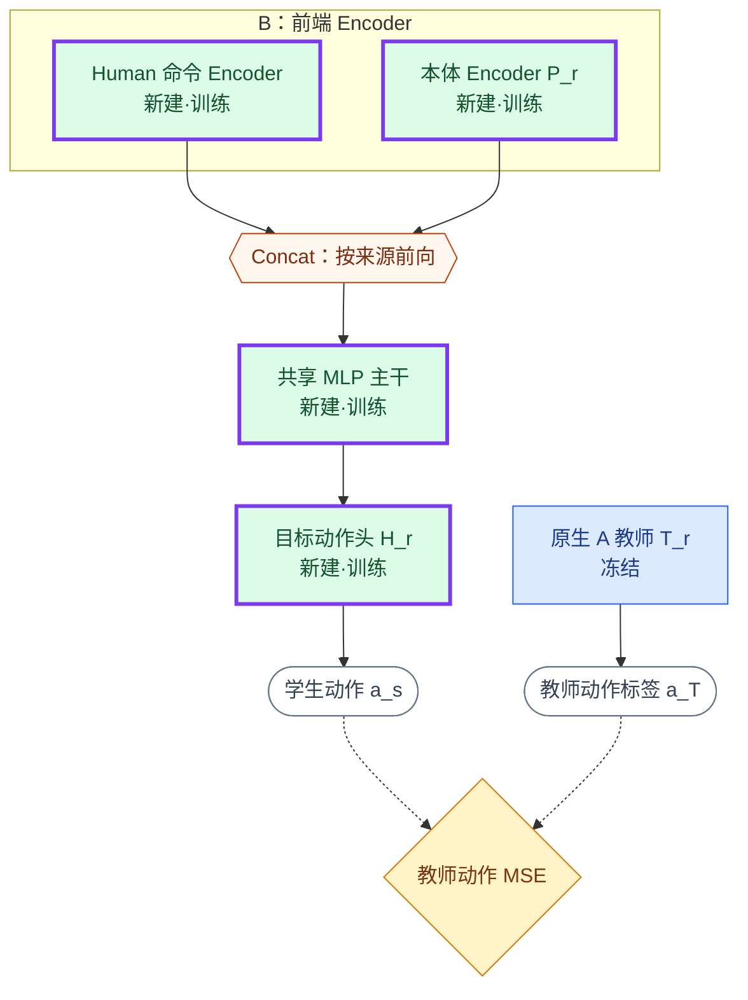
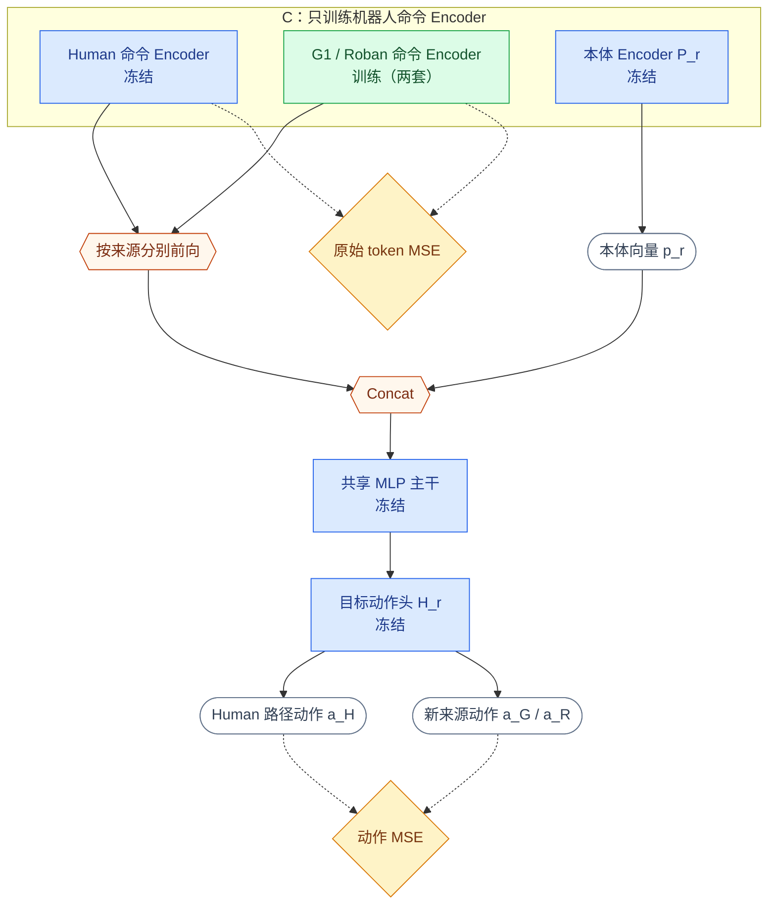

# 基础路线 A→B→C：先建立控制，再接通三种命令来源

> [研究总览](00_研究总览.md) · [后续：PPO微调](02_PPO微调_D阶段负结果.md)

**研究问题：两位原生教师的能力，能否先教给一个Human共享学生，再复用到机器人来源命令？** 本轮完成A10000、B2000、C2000。A教师验证成功率为G1 **99.4%**、Roban **98.4%**；B两路平均 **92.0%**；C六路平均 **93.50%**，建立了后续D/E实验的共同起点。

这三个学习阶段合为一条基础实验记录。B与C覆盖的路由不同，均值变化不能直接解释为控制能力提高。

| 开篇速览 | 本实验 |
|---|---|
| 网络 | 两独立特权教师；连续512→256来源/本体编码器，共享512→512→256 MLP，29/21维动作头。 |
| 训练 | A每教师10000轮PPO；B2000轮Human DAgger；C2000轮仅适配机器人来源。 |

## 1. 网络：教师独立，学生共享执行能力

### A：两个原生特权教师

每位教师读取对应原生命令、本体历史和仿真特权量，参数与优化器互不共享。Actor为1024→1024→512，critic为1024→512→256，使用原HEFT的LayerNorm/Mish MLP；输出分别为G1 29维、Roban 21维。

### B：Human命令与两套本体接口接入同一主干

命令/本体编码器为LayerNorm与512→256 ELU MLP；两个256维输出拼接，进入共享512→512→256主干和机型线性头。**A→B传递教师标签，学生不复制教师层或隐藏表示。** 本基础学生没有FSQ，也没有Transformer。输入窗口与动作历史见[总览](00_研究总览.md)。

### C：执行能力冻结，只训练机器人命令入口

G1/Roban命令编码器在B中已创建但未训练，C从这些原始参数开始学习。Human编码器、本体编码器、主干和动作头冻结；冻结主干仍将梯度传回新命令编码器。

## 2. 训练配方与监督机制

| 阶段 | 初始化与优化目标 | 训练模块 | 冻结模块 | 预算 |
|---|---|---|---|---|
| A | 两独立随机教师；PPO＋价值损失＋熵项 | actor、critic、log_std | 无学生 | 每教师4096环境、rollout32、10000轮；1,310,720,000 transitions |
| B | 随机学生；同状态原生教师动作MSE | Human编码器、本体编码器、主干、动作头 | 两机器人来源编码器、critic、log_std、教师 | 每机型1024环境、rollout16、2000轮；合计65,536,000 transitions |
| C | 加载B，新Adam和reservoir；原始token MSE＋动作MSE，权重均1 | G1/Roban命令编码器 | 其余学生模块及Human参照路径 | 同B采样与监督优化预算 |

A使用Adam lr=1e-4、3 epochs、minibatch8192、PPO clip0.2、entropy0.005、value0.5。B/C均为Adam lr=1e-4、每轮32次优化、batch2048/机型、每机型32768行uniform reservoir、梯度裁剪1；各64,000次优化，checkpoint间隔250轮。训练seed0；数据为simple_5k_v02。

**B的教师接管退出，不等于监督退出。** 每步学生与教师面对同一真实状态，先记录教师动作均值标签，再抽签决定谁执行一个完整动作；不混合两个动作，也不维护教师影子轨迹。教师查询发生在执行前，历史记录真正施加过的动作。第1–20轮全教师执行，第21轮仍为衰减起点，第521轮起纯学生执行；此后仍逐状态查询教师。奖励只作诊断，B没有PPO。

C的参照改为冻结Human学生；新来源token匹配同一配对窗口的Human原始token，动作匹配同一实际状态下的Human动作。前300轮将Human接管降至零，第301轮起由机器人来源独立执行。C不直接查询原生A作动作监督，这也为后来[E教师纠偏](03_教师纠偏_C到E.md)留下了研究问题。

监督误差先在每个机型的有效动作维度内平均，再跨机型等权；29维G1不会仅因维数多而获得更大权重。Uniform reservoir从累计访问历史中保留样本，并非只保留最近32768行。

## 3. 完整验证结果

| 阶段 / 路径 | 成功率 | 完成比例 | 根相对误差 | 世界误差 | 恢复片段 |
|---|---:|---:|---:|---:|---:|
| A：G1→G1 | 99.4% | 99.70% | 4.43 cm | 33.43 cm | 0 |
| A：Roban→Roban | 98.4% | 99.09% | 3.70 cm | 39.64 cm | 2 |
| B：Human→G1 | 93.4% | 96.85% | 8.40 cm | 86.90 cm | 0 |
| B：Human→Roban | 90.6% | 95.69% | 8.93 cm | 92.62 cm | 2 |
| C：human->g1 | 93.2% | 96.59% | 8.25 cm | 79.42 cm | 0 |
| C：g1->g1 | 94.8% | 97.59% | 8.20 cm | 77.59 cm | 0 |
| C：roban->g1 | 95.8% | 97.53% | 7.77 cm | 81.95 cm | 0 |
| C：human->roban | 90.8% | 95.66% | 9.57 cm | 100.52 cm | 2 |
| C：g1->roban | 93.2% | 96.60% | 9.37 cm | 97.88 cm | 2 |
| C：roban->roban | 93.2% | 96.22% | 9.11 cm | 95.59 cm | 2 |

每路500动作、83家族；A按各自原生路径、B按Human两路、C按六路评估。C的测试在后续纠偏实验中作为共同参考重新完成，平均成功率93.33%，见[教师纠偏](03_教师纠偏_C到E.md)。

### 两次准入决策要保留

1. A原始世界误差硬阈值未通过。2026-10-04按用户“完成与控制能力优先”的目标，将世界误差改为诊断；在原评分上重判，保存`eval_val_success_priority`，没有修改分数。
2. B原始相对教师门槛未通过。进入C前预先采用绝对能力标准：每路成功≥90%、完成≥95%、恢复≤1%、根相对误差≤10cm；相对教师退化保留为诊断，保存`eval_val_capability`。C仍按相对Human参照的原规则评价。

因此本轮的结论是“达到经明确调整的控制能力准入”，不是“学生无损复现教师”。这段历史会影响后续公平性判断，不能被最终通过标记覆盖。

## 4. 研究收获与观察方式

基础路线证明了已有两种执行机型、三种配对命令来源可以接入共享学生，但蒸馏仍有明显误差。C的监督来自Human学生，可能继承B的偏差；后续分别检验了奖励微调D和原生教师纠偏E。

读曲线时同时看`visited_state_action_mse`与回放`action_mse`：两者分布不同，后者很低不能代替闭环表现。`mixture_reward`在接管期含教师贡献；`recoveries`是数值状态恢复，不等于跌倒总数或评测失败率。C每机型的token/action MSE累加两个机器人来源，不能与B单来源损失等值比较。

## 5. 配置、复现与证据

| 内容 | 入口 |
|---|---|
| A/B配置 | [staged.yaml](../../cfg/xwbc/v02/staged.yaml) |
| C配置及B准入 | [source_adaptation.yaml](../../cfg/xwbc/v02/source_adaptation.yaml) |
| 模型与学习逻辑 | [分阶段模型](../../active_adaptation/learning/modules/xwbc_staged.py)、[训练器](../../active_adaptation/learning/xwbc_staged.py) |
| 运行操作 | [分阶段训练说明](../../docs/xwbc_v0.2分阶段训练.md)，各阶段使用新输出目录 |
| A教师 | [G1目录](../../logs/v0.2/staged_run01/teacher_g1/)、[Roban目录](../../logs/v0.2/staged_run01/teacher_roban/) |
| B最终权重与验证 | [权重](../../logs/v0.2/staged_run01/student_human/checkpoint_final.pt)、[原始评分](../../logs/v0.2/staged_run01/student_human/eval_val/summary.json)、[能力准入](../../logs/v0.2/staged_run01/student_human/eval_val_capability/gate.json) |
| C最终权重与验证 | [权重](../../logs/v0.2/staged_run01/source_encoders/checkpoint_final.pt)、[六路评分](../../logs/v0.2/staged_run01/source_encoders/eval_val/summary.json) |

A/B/C工程检查验证了冻结范围、真实状态监督、动作历史、checkpoint及阶段评分接口。本篇合并原01–05；完整运行过程仍在原日志目录，无需通过启动PID或早期轮次快照判断当前完成状态。
