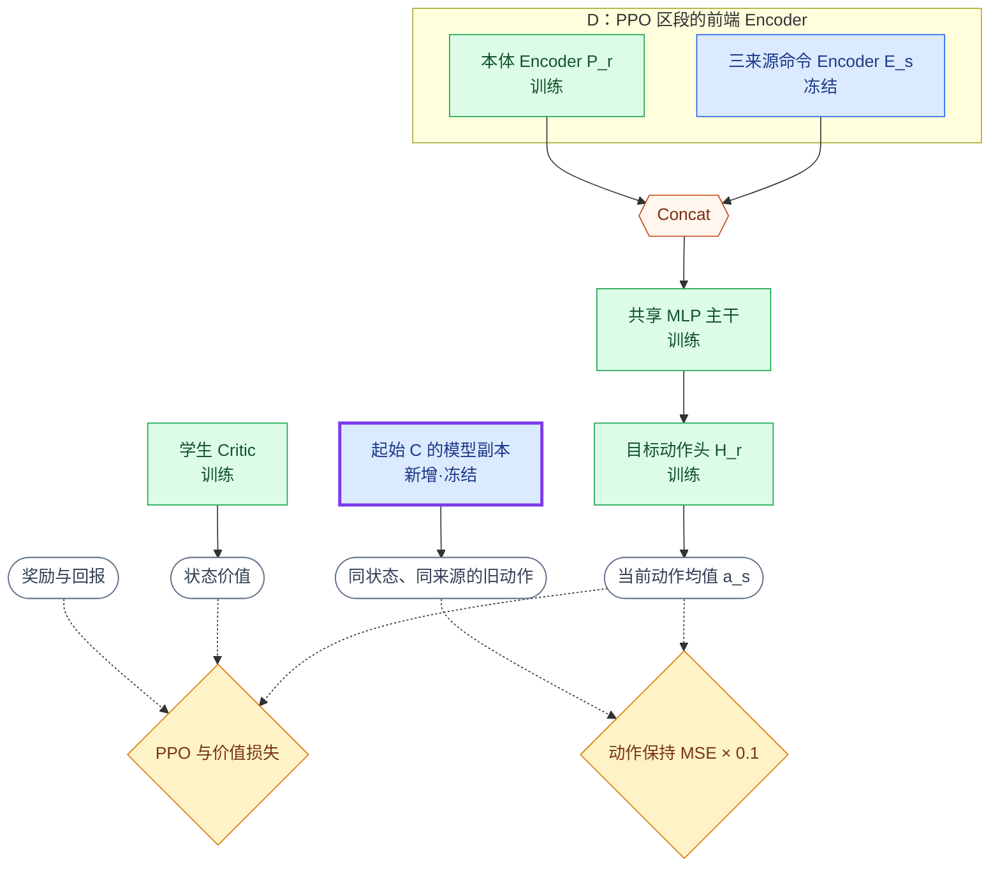

# PPO 微调 D：局部更新受控，完整跟踪仍明显退化

> [研究总览](00_研究总览.md) · [前因：基础A→B→C](01_基础路线_A到B到C.md) · [后续：改用教师纠偏](03_教师纠偏_C到E.md)

**研究问题：从已会六路控制的C出发，奖励驱动的保守PPO能否进一步提高困难动作能力？** 本轮完成100轮critic预热＋500轮PPO，但完整验证成功率从 **93.50%降至81.37%**，减少364个成功组合。D未通过能力门槛，保留为负结果；后续E从原C出发，未使用D权重。

| 开篇速览 | 本实验 |
|---|---|
| 网络 | 原C架构不变；三来源冻结，执行模块可微调；新增冻结C参照副本。 |
| 训练 | C起点；100轮critic预热＋500轮PPO，固定标准差0.1、局部KL≤0.02。 |

## 1. 网络与两段训练

学生仍是连续256维命令/本体token、共享512→512→256 MLP与机型线性头；没有新网络层。B/C原有但未训练的critic在D开始学习，另复制冻结C作为动作参照。

| 区段 | 更新模块 | 冻结模块 | 执行与监督 |
|---|---|---|---|
| 1–100轮：critic预热 | 两机型critic | actor动作均值参数与三来源编码器 | 固定标准差0.1的策略采样；只拟合价值 |
| 101–600轮：PPO | 本体编码器、共享主干、动作头、critic | 三来源编码器、标准差、C参照 | PPO＋价值损失＋0.1×同状态同来源C动作保持 |

D不查询A教师标签，不使用B/C监督reservoir。标准差从B/C未训练的1显式改为固定0.1；这是微调配方的一部分。

## 2. 训练细节与关键工程修正

| 参数 | 设置 |
|---|---|
| 初始化 | C最终权重，新优化器；不加载工程短检权重 |
| 每机型环境 / rollout | 1024 / 32步，来源槽位固定342/341/341 |
| 总预算 | 600轮，39,321,600 transitions；100预热＋500PPO |
| 学习率 | actor 2e-5，critic 1e-4 |
| PPO | 3 epochs、minibatch8192、clip0.1、解析KL上限0.02 |
| 保持与保存 | 冻结C动作MSE×0.1；梯度裁剪1，每50轮保存 |

第一次工程检查发现：仅在下一minibatch检查KL，不能撤回已经过冲的更新（首步KL约3.60）。正式实现改为每次Adam提议后回溯缩小参数增量，最多10次；完全拒绝则恢复actor参数和Adam状态，critic更新独立保留。正式应用的minibatch KL最大约0.019993，确实受控。

## 3. 完整验证

| 划分 / 终点 | 模型 | 成功率 ↑ | 完成比例 ↑ | 根相对误差 ↓ | 世界误差 ↓ |
|---|---|---:|---:|---:|---:|
| 验证 | C | 93.50% | 96.70% | 8.71 cm | 88.82 cm |
| 验证 | D600 | 81.37% | 91.25% | 13.40 cm | 164.54 cm |

| 路径 | C成功率 | D成功率 | 差值 |
|---|---:|---:|---:|
| Human→G1 | 93.2% | 71.8% | −21.4个百分点 |
| G1→G1 | 94.8% | 76.0% | −18.8个百分点 |
| Roban→G1 | 95.8% | 74.2% | −21.6个百分点 |
| Human→Roban | 90.8% | 85.8% | −5.0个百分点 |
| G1→Roban | 93.2% | 90.4% | −2.8个百分点 |
| Roban→Roban | 93.2% | 90.0% | −3.2个百分点 |

每路500动作、83家族，总3000条。G1退化覆盖走路、跑步、上身，主要终止类型为body_z_termination。Human→G1中，112条原C成功动作变为失败，只挽救5条原C失败动作；成功率差的家族区间约[−26.70,−17.06]个百分点。

## 4. 为什么“训练正常”没有换来性能提升

- **局部KL约束不限制相对起始C的累计漂移。** 数值有限、KL通过只能说明该工程约束执行，不能保证原能力保持。
- critic解释方差上升时，actor奖励和成功率仍下降；价值拟合与策略改进不是同一指标。
- 固定C回放状态进行模块替换，六路动作MSE：仅换主干0.00708，仅换本体编码器＋动作头0.01200，全部换D为0.03212。私有模块不能忽略；这些是动作敏感性诊断，不是闭环因果消融，数值不可相加成贡献比例。
- 对冻结最终D新采样三批状态，跨机器人PPO主干梯度余弦约0.00694–0.01303，未见强负相关；保持项梯度范数仅为PPO的0.09%–0.24%。这支持“此时保持项偏弱”，不能证明全程无梯度冲突或确定唯一失败原因。

后续若重访D，应分别研究累计漂移约束、更新哪些执行模块、critic信息与优势估计。原记录提出过检查早期checkpoint和加强保持项等方案；它们是待验证建议，不能写成已经完成的实验。

## 5. 配置与证据

- [D配置](../../cfg/xwbc/v02/finetune.yaml)、[PPO微调实现](../../active_adaptation/learning/xwbc_finetune.py)、[操作说明](../../docs/xwbc_v0.2分阶段训练.md)。
- [正式运行与最终权重](../../logs/v0.2/staged_run01/finetune_ppo/)、[完整验证](../../logs/v0.2/staged_run01/finetune_ppo/eval_val/summary.json)。
- [配对比较与模块/梯度诊断](../../logs/v0.2/staged_run01/finetune_ppo/analysis_20261005/)、[工程检查](../../logs/v0.2/staged_run01/stage_d_preparation/validation_summary.json)。

本篇合并原06–07，启动与调度细节可在原运行目录追溯。本结论只针对当前C起点与D配方，不推广为PPO在该任务上普遍无效。
