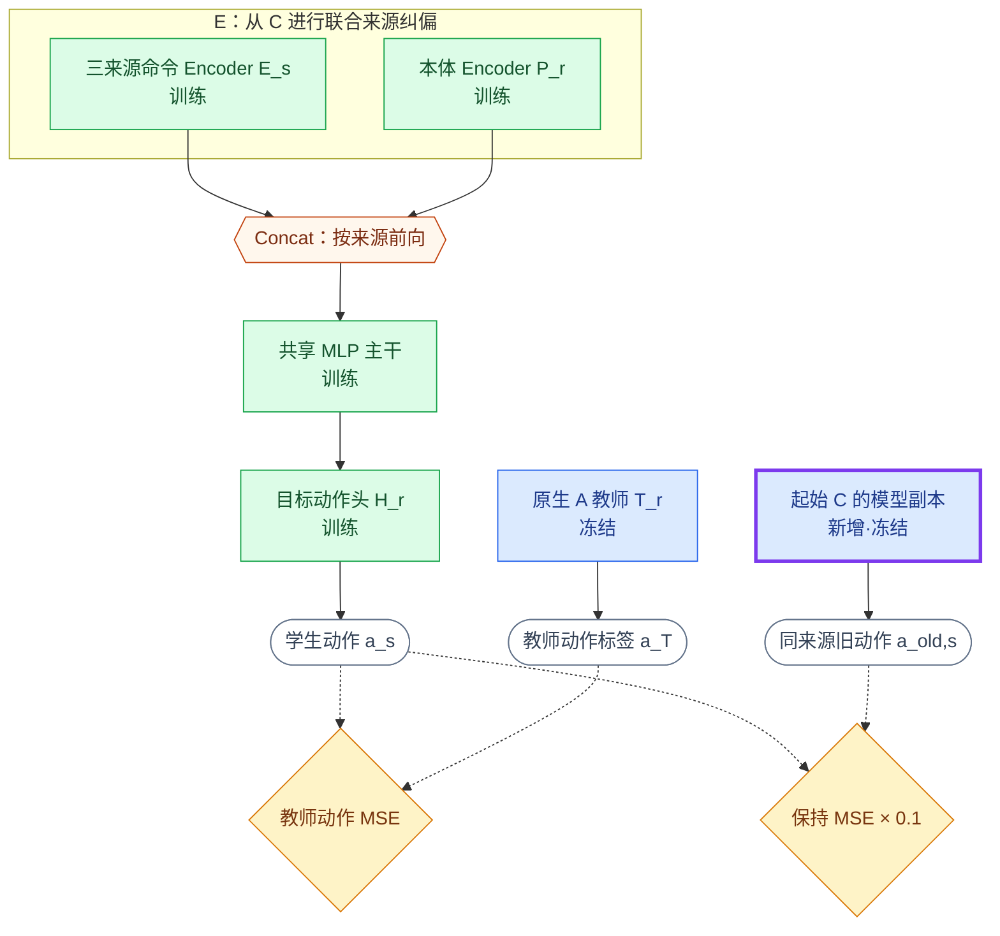
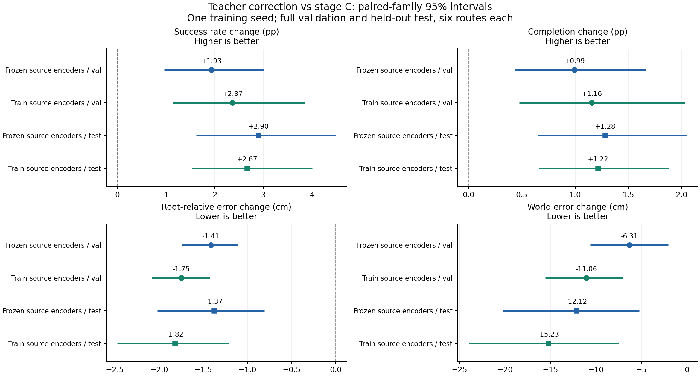

# C→E 教师纠偏：让六种来源路径重新向原生教师学习

> [研究总览](00_研究总览.md) · [前因：PPO微调退化](02_PPO微调_D阶段负结果.md) · [后续：检验是否还需要C](04_去除C_A到B到E.md)

**研究问题：C的来源适配继承了Human学生的误差，原生A教师能否继续纠正六路控制？** 两组实验均从同一C出发，比较冻结命令编码器与联合更新命令编码器。测试前按验证选定**联合来源E300**，完整测试成功率由C的 **93.33%提高到96.00%**；完成比例及两类误差的总体区间也支持改善。

| 开篇速览 | 本实验 |
|---|---|
| 网络 | 原C连续MLP结构；对照只改变三来源编码器是否冻结。 |
| 训练 | 两组各E300；六路教师动作监督＋0.1冻结C保持，lr1e-5，纯学生执行。 |

## 1. 网络与改动位置



架构没有新增可训练层：连续命令/本体编码器各512→256，共享主干512→512→256，输出G1/Roban的29/21维动作。新增的是一份**冻结C副本**。图画联合来源组；冻结来源组只把三个命令编码器改为冻结，其余完全相同。

学生独立控制一条真实轨迹；同一状态的Human/G1/Roban三路输入都向执行机型对应的A教师动作学习。教师与旧C只生成训练标签，评估不接管、不提供特权输入给学生。

## 2. 两组完整训练设计

| 项目 | 冻结来源组 | 联合来源组（选定） |
|---|---|---|
| 起点 | 同一C最终学生，新Adam与空reservoir | 相同 |
| 训练 | 本体编码器、共享主干、动作头 | 左列＋三种命令编码器 |
| 冻结 | 三来源编码器、critic、标准差、A与C副本 | critic、标准差、A与C副本 |
| 损失 | 教师动作MSE＋0.1×同来源固定C动作MSE | 相同 |
| 环境与采样 | 每机型1024环境，rollout16，每机型32768行reservoir | 相同 |
| 优化 | Adam lr=1e-5；每轮16次，batch1024/机型；裁剪1 | 相同 |
| 预算 | 300轮、9,830,400 transitions、4800次优化 | 相同 |
| 教师接管 / PPO | 0 / 0 | 0 / 0 |

单路损失可等价写为对 `(a_teacher+0.1*a_C)/1.1` 的回归，另加与学生动作无关的常数；这是监督目标的代数解释，不是执行动作的混合，也不能证明保持项单独带来了收益。

## 3. 选模过程：保留真实取舍

冻结来源组完整验证E100/200/300。预设选择条件要求成功率改善、完成比例不下降、两类误差不增加且恢复片段不增加。

| 验证候选 | 成功率 | 完成比例 | 根相对误差 | 世界误差 | 选择 |
|---|---:|---:|---:|---:|---|
| C | 93.50% | 96.70% | 8.71 cm | 88.82 cm | 参照 |
| 冻结来源E100 | 94.40% | 97.36% | 7.55 cm | 83.88 cm | 达标 |
| 冻结来源E200 | 95.63% | 97.60% | 7.37 cm | 81.94 cm | 一路恢复由2增至3，未入选 |
| 冻结来源E300 | 95.43% | 97.69% | 7.30 cm | 82.51 cm | 组内选定 |
| 联合来源E300 | **95.87%** | **97.85%** | **6.96 cm** | **77.77 cm** | 最终选定 |

联合来源组在查看自身验证/测试结果前，改为优先完整评估最终300轮，保留100/200权重；它与冻结来源E300构成相同训练量对照。最终选择在查看测试性能前锁定。

一个必须保留的事实：冻结来源E300测试成功率为**96.23%**，高于选定模型的96.00%，但根相对/世界误差为7.38/78.51cm，更大。没有按测试成功率重新换模。联合来源相对冻结来源的额外收益，在验证两类精度上获区间支持，成功率和完成比例区间跨零。

## 4. 最终验证与测试

| 划分 / 终点 | 模型 | 成功率 ↑ | 完成比例 ↑ | 根相对误差 ↓ | 世界误差 ↓ |
|---|---|---:|---:|---:|---:|
| 验证 | C | 93.50% | 96.70% | 8.71 cm | 88.82 cm |
| 验证 | 联合来源E300 | 95.87% | 97.85% | 6.96 cm | 77.77 cm |
| 测试 | 联合来源E300 | 96.00% | 97.91% | 6.94 cm | 75.40 cm |

C对应测试为：成功93.33%、完成96.70%、根相对8.75cm、世界90.63cm。成功组合2800→2880，净增80。测试差值的家族配对95%区间：成功率[+1.53,+4.01]个百分点，完成比例[+0.66,+1.88]个百分点，根相对[−2.47,−1.21]cm，世界[−23.99,−7.49]cm。

| 测试路径 | 成功率 C→E | 根相对误差 C→E | 世界误差 C→E |
|---|---:|---:|---:|
| Human→G1 | 92.8%→95.2% | 8.70→7.59 cm | 82.79→71.84 cm |
| G1→G1 | 94.2%→97.2% | 8.44→6.93 cm | 84.78→67.89 cm |
| Roban→G1 | 95.8%→96.2% | 8.19→6.68 cm | 78.32→63.70 cm |
| Human→Roban | 89.8%→94.8% | 8.78→7.65 cm | 103.34→90.47 cm |
| G1→Roban | 94.0%→95.6% | 9.39→6.52 cm | 102.72→79.11 cm |
| Roban→Roban | 93.4%→97.0% | 9.03→6.25 cm | 91.84→79.42 cm |



测试六路四项点估计均改善，但部分单路成功率区间跨零，不能写成每路显著提升。验证Human→G1世界误差反而增加2.72cm，其他五路下降。双方测试恢复片段均为0，验证恢复数保持原水平。

## 5. 为什么这一步重要

它表明，共享学生可以在既有输入条件下，通过原生教师的同状态六路监督继续改进，推动研究从奖励微调回到监督学习。下一步的问题因此变成：**既然E能直接教三个来源，还必须先做C的Human token/action对齐吗？** 这由下一篇去C实验检验。

本轮未分别消融保持项、学习率与各模块，不能把全部收益归因于某一项。也未证明可以无损弥补学生缺少教师特权信息的差距。

## 6. 复现与证据

验证固定64环境；在任何测试运行之前将双方测试环境数预设为500，重新评估C并共享这份C测试。实际权重、数据/动作集合、原始评分、环境JSON、代码和选模时序均通过审计。

- [冻结来源配置](../../cfg/xwbc/v02/teacher_refinement.yaml)、[联合来源配置](../../cfg/xwbc/v02/teacher_refinement_all_sources.yaml)。
- [选定E300权重](../../logs/v0.2/refinement_20261005/all_sources_run01/checkpoint_300.pt)、[测试前锁定记录](../../logs/v0.2/refinement_20261005/final_selection.json)。
- [验证比较](../../logs/v0.2/refinement_20261005/all_sources_run01/comparison_val_300.json)、[测试比较](../../logs/v0.2/refinement_20261005/all_sources_run01/comparison_test.json)、[最终审计](../../logs/v0.2/refinement_20261005/final_test_audit.json)。
- [运行与全部候选](../../logs/v0.2/refinement_20261005/)、[完整结果状态](../../logs/v0.2/refinement_20261005/final_result.json)。

在项目根目录，用新输出目录复现选定配方：

```bash
env -u LD_LIBRARY_PATH OMP_NUM_THREADS=4 OPENBLAS_NUM_THREADS=1 \
  .venv/bin/python -u -B scripts/run_xwbc_refinement_variant.py \
  --config cfg/xwbc/v02/teacher_refinement_all_sources.yaml \
  --output logs/v0.2/refinement_reproduction_seed0 \
  --eval-iterations 300 --test-num-envs 500
```

这是当时验证驱动选模、再做独立测试的实验；后续记录中对同一测试集的再次使用应另行说明。
