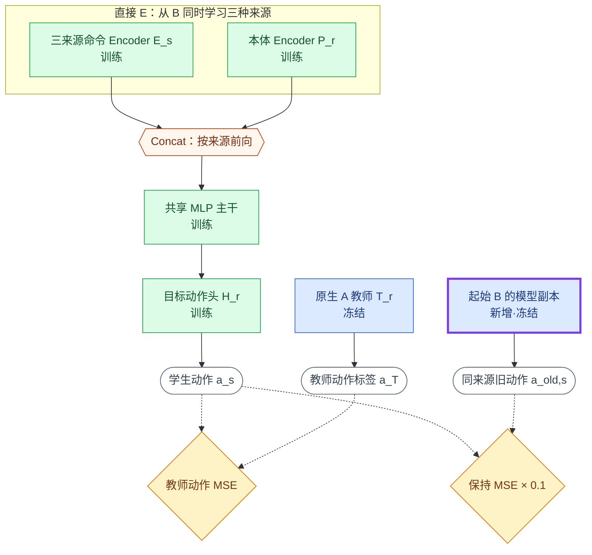
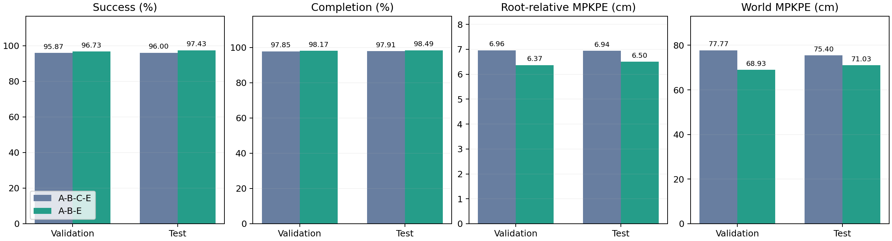
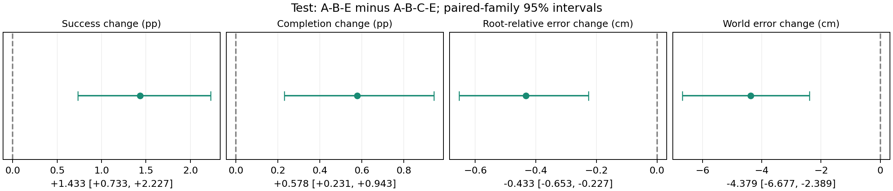

# 去除 C：A→B→E 成为后续实验的训练范式

> [研究总览](00_研究总览.md) · [前因：C后教师纠偏有效](03_教师纠偏_C到E.md) · [后续：加入FSQ](07_FSQ命令表征_当前主基线.md)

**研究问题：在相同B后续预算下，直接用A教师训练六路，能否替代C的来源适配？** 从同一B与同一A出发，直接E2300的测试成功率由A→B→C→E的 **96.00%提高到97.43%**；测试四项总体差值区间均支持改善。此结果确立A→B→E作为后续优先路线，连续表征版本保留为对照。

| 开篇速览 | 本实验 |
|---|---|
| 网络 | 原B连续MLP结构；三个命令编码器及执行模块在E联合训练。 |
| 训练 | 复用A/B，只新做E2300；匹配原C2000＋E300采样/优化预算。 |

## 1. 网络与路线变化



学生仍使用连续命令/本体512→256编码器、共享512→512→256 MLP与29/21维线性头，没有FSQ。B中未训练的机器人来源编码器原样载入，并在直接E中首次学习。全部actor模块参与E；critic、标准差与教师冻结。

两条路线的对照为：

```text
共同A、B ── C2000（只训练机器人来源）── E300（六路教师监督）
       └── 直接E2300（全程六路教师监督）
```

直接E没有经过C，也没有加载任何C/E权重或动作作标签。训练参照是本次起始B的冻结副本；旧最终E评分仅作评估参考。

## 2. 预算匹配与训练细节

| B之后的区段 | 轮数 | 每轮优化×batch/机型 | transitions | 优化次数 |
|---|---:|---:|---:|---:|
| 原C | 2000 | 32×2048 | 65,536,000 | 64,000 |
| 原E | 300 | 16×1024 | 9,830,400 | 4800 |
| 直接E前段 | 2000 | 32×2048 | 65,536,000 | 64,000 |
| 直接E后段 | 300 | 16×1024 | 9,830,400 | 4800 |

两路线B之后均为2300轮、75,366,400 transitions、68,800次优化、271,974,400次回放抽样。直接E全程保持同一目标、Adam和reservoir，第2000轮不重置；两个区段仅改变优化次数与batch。

- 每机型1024环境，rollout16，每机型32768行reservoir，seed0。
- Adam lr=1e-5，梯度裁剪1；学生独立执行，PPO与教师接管均为0。
- 每个实际状态的三种来源都接受同一执行机型A教师动作监督；有效动作维度、来源、机型依次等权。
- 损失：教师动作MSE＋0.1×冻结B同来源动作MSE。B未训练的机器人来源也用于保持，可能限制初期学习；本轮没有同时改保持规则。

这是一项路线级比较：C与E的监督、可训练模块和学习率不同，不能说是等FLOPs或只替换单一损失。原路线E保持起始C，直接E保持起始B。

## 3. 固定终点的完整结果

| 划分 / 终点 | 模型 | 成功率 ↑ | 完成比例 ↑ | 根相对误差 ↓ | 世界误差 ↓ |
|---|---|---:|---:|---:|---:|
| 验证 | A→B→C→E | 95.87% | 97.85% | 6.96 cm | 77.77 cm |
| 验证 | A→B→E | 96.73% | 98.17% | 6.37 cm | 68.93 cm |
| 测试 | A→B→C→E | 96.00% | 97.91% | 6.94 cm | 75.40 cm |
| 测试 | A→B→E | 97.43% | 98.49% | 6.50 cm | 71.03 cm |

测试净增43个成功组合：新增成功76、退化33、双方成功2847、双方失败44。跑步成功750/792→772/792，走路1509/1578→1524/1578，上身621/630→627/630。

| 总体差值的95%区间（去C减原路线） | 验证 | 测试 |
|---|---:|---:|
| 成功率，百分点 | [+0.1389,+1.6414] | [+0.7326,+2.2266] |
| 完成比例，百分点 | [−0.1493,+0.7796] | [+0.2308,+0.9426] |
| 根相对误差，cm | [−0.8259,−0.3594] | [−0.6529,−0.2268] |
| 世界误差，cm | [−15.1938,−3.6950] | [−6.6770,−2.3892] |



### 逐路取舍

| 测试路径 | 成功率 原路线→直接E | 根相对误差 原路线→直接E | 世界误差 原路线→直接E |
|---|---:|---:|---:|
| Human→G1 | 95.2%→97.2% | 7.59→6.95 cm | 71.84→65.20 cm |
| G1→G1 | 97.2%→96.8% | 6.93→6.52 cm | 67.89→64.17 cm |
| Roban→G1 | 96.2%→97.6% | 6.68→6.52 cm | 63.70→59.55 cm |
| Human→Roban | 94.8%→96.4% | 7.65→6.99 cm | 90.47→81.67 cm |
| G1→Roban | 95.6%→98.2% | 6.52→6.20 cm | 79.11→83.87 cm |
| Roban→Roban | 97.0%→98.4% | 6.25→5.84 cm | 79.42→71.68 cm |

测试G1→G1成功率与完成比例下降，G1→Roban世界误差增加4.76cm；验证Roban→G1成功率下降1个百分点。总体改善不能写成每路全面改善。双方测试恢复片段均0，验证逐路均为0/0/0/2/2/2。



## 4. 研究判断

当前配方下，直接六路教师监督优于先经Human token/action对齐再纠偏。后续结构实验应固定A→B→E，避免同时更换训练路线。但这并不能分解C的token目标、接管课程、初始化与保持项各自的贡献，也不能证明C在其他数据或条件下无用。

U实验继续追问“B能否也合并掉”；FSQ则在保留B/E分工下研究命令表征。两条后续分支分别见[U与来源课程](05_联合训练_U与来源课程.md)、[FSQ](07_FSQ命令表征_当前主基线.md)。

## 5. 复现与证据

E2300在训练前固定，其他checkpoint不用于本轮主模型选择。验证64环境、测试500环境、seed42，各3000条；实际权重、同条件环境、原始评分和预算均核验通过。测试集此前已查看，未按测试重选终点。

- [配置](../../cfg/xwbc/v02/teacher_refinement_no_c.yaml)、[自动队列](../../scripts/run_xwbc_no_c_ablation.py)。
- [固定E2300](../../logs/v0.2/no_c_ablation_20261005/direct_e_run01/checkpoint_2300.pt)、[验证比较](../../logs/v0.2/no_c_ablation_20261005/direct_e_run01/comparison_val.json)、[测试比较](../../logs/v0.2/no_c_ablation_20261005/direct_e_run01/comparison_test.json)。
- [最终评分审计](../../logs/v0.2/no_c_ablation_20261005/direct_e_run01/final_evaluation_audit.json)、[权重训练审计](../../logs/v0.2/no_c_ablation_20261005/direct_e_run01/checkpoint_2300.audit.json)、[数据与代码审计](../../logs/v0.2/no_c_ablation_20261005/direct_e_run01/data_code_audit.json)。
- [训练诊断图](analysis/no_c_ablation_20261005/training_diagnostics.png)。训练耗时6983.48秒，恢复计数G1/Roban为0/735；该计数不是完整片段失败率。

新输出父目录先创建，再从项目根运行：

```bash
mkdir -p logs/v0.2/no_c_reproduction
env -u LD_LIBRARY_PATH OMP_NUM_THREADS=4 OPENBLAS_NUM_THREADS=1 \
  .venv/bin/python -u -B scripts/run_xwbc_no_c_ablation.py \
  --output logs/v0.2/no_c_reproduction/direct_e_run01
```
