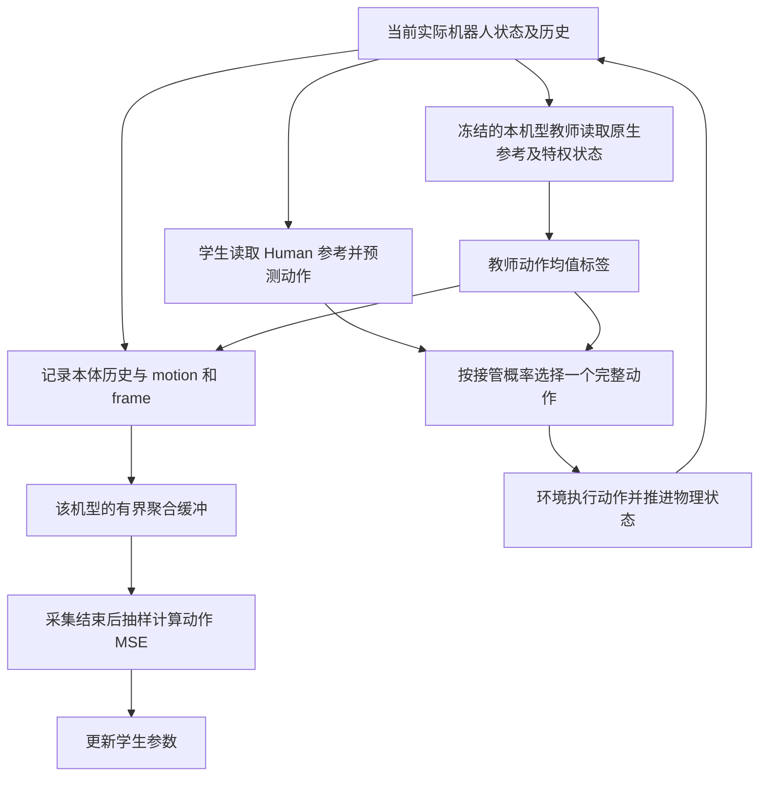

# 阶段 B 学生独立执行与监督机制

本文解释 v0.2 阶段 B 中，学生开始自己控制机器人后，谁提供监督、训练如何进行，以及怎样判断学生真正学会了。内容依据本工作树代码和正式运行配置核对，日期为 2026 年 10 月 4 日（北京时间）。本文说明训练机制，不代表本次训练已经完成或通过验收。

**学生独立执行以后，仍由阶段 A 的冻结教师提供动作监督。退出的是教师的执行接管，不是教师的标签查询。** G1 状态由 G1 教师标注，Roban 状态由 Roban 教师标注；教师每次都看学生实际到达的状态，回答“在这个状态下，我会输出什么动作”。训练程序积累这些样本，再更新学生参数。

## 谁负责执行 谁负责监督

| 角色 | 阶段 B 中的职责 | 学生完全接手以后 |
|---|---|---|
| 共享学生 | 从 Human 参考与目标机器人本体历史预测动作 | 每一步实际控制机器人 |
| 两个冻结教师 | 对各自机型的当前真实状态给出动作均值标签 | 仍逐步查询，但不执行动作 |
| 监督优化器 | 缩小学生动作与教师标签的误差 | 继续更新学生的可训练模块 |
| 仿真环境 | 推进物理状态，计算奖励和终止，执行已有恢复机制 | 继续反馈状态；奖励不用于 B 的策略梯度更新 |
| 独立验证流程 | 检查纯学生完整片段的表现 | 不让教师接管，以验收指标判断能力 |

“监督”在这里是**提供训练目标**。当前代码没有一个根据危险程度实时决定救场的教师控制器。接管由预先设定的概率日程决定；接管概率为零时，即使教师给出不同动作，也不会替学生执行。

## 阶段 B 要学会什么

阶段 A 已训练两个互不共享参数的特权教师，分别解决本机型原生参考跟踪。阶段 B 新建一个共享学生，学习两条路径：Human → G1 和 Human → Roban。

一条 motion_id 对应 Human、G1、Roban 三份同步参考。以 G1 为例，学生读 Human 参考，教师读配对的 G1 原生参考；二者面对同一台 G1、同一实际状态、同一动作进度。Human 表示命令来源，不表示此处有真人逐步操作或人工标注。

学生的计算路径为：

```text
Human 参考窗口 → Human 命令编码器 → 256 维命令 token ─┐
                                                     ├→ 拼接 → 共享 MLP → 目标机型动作头
目标机器人的本体与实际动作历史 → 机型本体编码器 → 256 维 ─┘
```

共享 MLP 的隐藏层为 `[512, 512, 256]`。G1 与 Roban 各有自己的本体编码器和动作头，共享 Human 命令编码器与主干。B 更新以上模块；G1/Roban 命令编码器、critic、策略标准差和两个教师保持冻结。B 不对齐两个教师的隐藏表示，也不进行 PPO 更新。

学生输入包含 12 个参考时刻、9 个本体历史时刻以及最近 8 个实际动作。教师额外能看到仿真中的参考关节和根误差、真实根线速度与高度、关键点位姿和速度等特权信息。这些额外信息用于生成标签，不作为学生动作网络的直接输入。

## 一个控制步怎样产生训练样本

以下流程对两种目标机型分别执行。每个环境只有一条实际轨迹，不维护另一条教师影子轨迹。



具体顺序是：

1. 读取当前实际状态与历史，并按 motion_id 和 frame 取得配对参考窗口。
2. 学生输出 Human 路径动作；本机型教师在**同一执行前状态**输出动作均值。
3. 将本体历史、motion、frame 和教师标签加入该机型缓冲。命令窗口在训练抽样时可由 motion 和 frame 重新读取。
4. 每个环境、每个控制步独立抽签，决定执行教师动作还是学生动作。代码选择其中一个完整动作，不做两个动作的加权插值。
5. 环境推进一步，记录真正施加过的动作；遇到 `done` 时重置对应环境，然后继续采集。

采集发生在 `no_grad` 下，不通过仿真反向传播。教师标签已经 detach；学生参数在后续监督更新阶段变化，而不是刚走一步就立刻更新一次。

例如，学生把 G1 控制得向前偏了一点，下一步教师会根据“已经向前偏”的实际状态重新给出动作，而不是照抄教师原先理想轨迹在同一时刻的动作。这让学生有机会学到自己造成的偏差状态下应该怎样行动。不过，教师在任意偏离状态都能救回机器人，并没有保证。

## 接管概率降为零以后发生什么

令 `i` 为从 0 开始的采集迭代索引。当前代码使用：

```text
i < 20 时： beta = 1
i ≥ 20 时： beta = max(0, 1 - (i - 20) / 500)
```

日志中的 `update = i + 1`，因此要注意一轮的索引差异。

| 日志中的轮次 update | 教师接管概率 beta | 实际执行情况 | 教师标签 |
|---|---:|---|---|
| 1 至 20 | 1 | 教师执行，学生开始拟合 | 每一步都有 |
| 21 | 1 | 衰减起点仍为教师全执行 | 每一步都有 |
| 271 | 0.5 | 期望一半环境步由教师执行 | 每一步都有 |
| 520 | 0.002 | 几乎全由学生执行 | 每一步都有 |
| 521 至 2000 | 0 | 完全由学生执行 | 每一步都有 |

**从第 521 轮起，执行权完全交给学生，但教师仍为每个采集状态提供标签。** `beta` 只控制执行动作的选择；教师查询和样本写入发生在选择之前，不受 `beta = 0` 影响。

这就是本实现中 DAgger 式在线数据聚合的关键：随着学生接手，训练样本越来越包含学生自己访问的状态，再由教师对这些状态进行标注。“在线”指随交互不断采集与训练，不意味着真机部署时必须在线学习。

## 每轮训练的预算与损失

正式运行配置与 `cfg/xwbc/v02/staged.yaml` 一致：

| 项目 | 当前设置 |
|---|---:|
| 每机型并行环境 | 1024 |
| 每轮每环境采集步数 | 16 |
| 每轮新增状态标签 | 每机型 16384 条，两机型共 32768 条 |
| 每机型缓冲容量 | 32768 条 |
| 每轮监督优化步数 | 32 |
| 每个优化步的抽样量 | **每机型** 2048 条，总计 4096 条 |
| 优化器与学习率 | Adam，0.0001 |
| 梯度范数裁剪上限 | 1.0 |
| 计划采集迭代 | 2000 轮 |
| checkpoint 间隔 | 250 轮 |

每轮先采集两机型的数据，再进行 32 次监督优化。每个优化步分别计算两机型误差，再合成一次参数更新。完整预算是 65,536,000 个环境 transitions 和 64,000 次监督优化步；两者不是同一种“更新次数”。抽样有放回，训练样本可以重复使用。

对目标机型 r，设抽样量为 N，有效动作维数为 d_r：

```text
L_r = sum((学生动作[n,j] - 教师动作均值[n,j])²) / (N × d_r)
L_B = (L_G1 + L_Roban) / 2
```

先对各机型自己的有效动作维度求平均，再对两机型等权平均，避免动作维数较多的机型仅因维数多而占据更大权重。监督的是网络控制动作空间中的教师均值，经相同动作接口进入 HEFT 控制链；不能把它直接理解为数据集里的参考关节角标签。

B 的损失中没有 PPO、价值损失或奖励加权项。`mixture_reward` 仅记录当时实际执行策略的奖励，用于观察训练过程。

## 为什么需要缓冲和真实动作历史

如果只在教师轨迹上拟合，学生一旦执行出小误差，就可能进入训练时很少见过的状态。B 在实际访问状态上重新查询教师，使监督数据覆盖学生自己造成的状态偏移。

缓冲使用 uniform reservoir，即在容量固定的情况下，从累计访问样本中保留均匀随机样本。它既不是无限保存所有轨迹，也不是只保存最近 32768 条。缓冲中的样本可能来自早期教师执行、混合执行和后期学生独立执行；累计访问数量 `replay_seen` 可以远大于实际容量。

这也有局限：最新状态不保证全部保留，罕见的困难状态也没有额外优先权。若后期当前状态误差持续较高，需要结合纯学生评估判断覆盖是否足够，不能只看缓冲上的训练误差。

实际动作历史同样重要：上一时刻执行教师动作，历史就应记录教师实际施加的动作；执行学生动作，就记录学生实际施加的动作。本实现从 HEFT 已施加动作缓冲读取历史，不拿未执行的学生预测冒充历史。

checkpoint 保存学生、优化器、聚合缓冲和随机状态。恢复训练会重开仿真回合，不等于从保存瞬间的物理状态逐位续跑。

## 如何看出学生真正学会了

训练过程中可以联合看以下指标：

| 指标 | 含义与阅读方式 |
|---|---|
| `beta` 和 `takeover_fraction` | 计划接管概率与实际接管比例；随机采样使二者不必完全相等 |
| `visited_state_action_mse` | 本轮采集时、当前实际访问状态上的学生与教师动作误差；发生在本轮监督更新之前 |
| `action_mse` | 从聚合缓冲抽样训练时的动作误差，日志汇总本轮各优化步 |
| `mixture_reward` | 本轮实际执行策略的奖励；有接管时包含教师贡献 |
| `recoveries` | 环境累计非有限状态恢复计数，不是教师接管次数，也不等同于所有跌倒次数 |

缓冲误差很低而当前访问状态误差偏高，可能提示学生对当前状态分布拟合不足，但两类数据不同，不能仅据一次数值差异下结论。即使动作误差都很低，也不能直接推出长片段控制成功；小误差会经闭环动力学积累。

最终验收使用独立的 **Human → G1 与 Human → Roban 纯学生评估**，每条路径覆盖完整 500 条验证动作，不让教师接管。相对各自已验收教师，当前 B 门槛为：

- 成功率最多下降 5 个百分点。
- 完成比例最多下降 5 个百分点。
- 根相对 MPKPE 最多增加 0.02 m。
- 发生恢复的片段比例不超过 1%，指标须有限且覆盖完整。
- 世界坐标 MPKPE 增量超过 0.05 m 会记录诊断；本轮配置不将其作为阻断项。

“下降 5 个百分点”是绝对比例差，例如 99.4% 对应约 94.4%，不是乘以 95%。准确判定使用评估文件中的未舍入数值。

当前配置没有根据上述训练曲线自动延后接管衰减的逻辑。教师监督也无法保证在任意状态都有高质量标签，因此独立验证仍是必需环节。B 通过后，阶段 C 才冻结 Human 执行路径并学习 G1/Roban 命令入口；B 本身尚不代表六种来源与机型组合都已学会。

## 对照源码与运行记录

- [训练主循环与验收逻辑](../../active_adaptation/learning/xwbc_staged.py)：`query_teacher`、`takeover_probability`、`dagger_collect`、`supervised_update`、`train_student`、`gate_decision`。
- [模块冻结与聚合缓冲](../../active_adaptation/learning/modules/xwbc_staged.py)：`configure_student`、`action_mse`、`Reservoir`。
- [同状态特权信息](../../active_adaptation/envs/xwbc_staged.py)：`StagedPool.teacher_observation`。
- [实际动作历史与环境步进](../../active_adaptation/envs/xwbc.py)：`history_observation`、`step`。
- [分阶段配置](../../cfg/xwbc/v02/staged.yaml)与[正式运行配置](../../logs/v0.2/staged_run01/student_human/config.json)。
- [阶段 B 正式运行记录](03_阶段B正式运行记录.md)与[分阶段训练说明](../../docs/xwbc_v0.2分阶段训练.md)。

文中的 Mermaid 图可在支持 Mermaid 的 Markdown 阅读器中显示；即使不渲染，紧随其后的步骤也完整描述了数据流。
