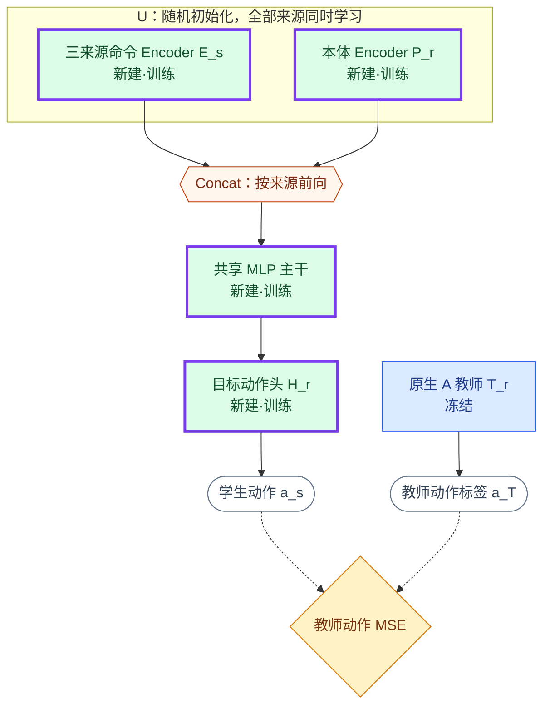
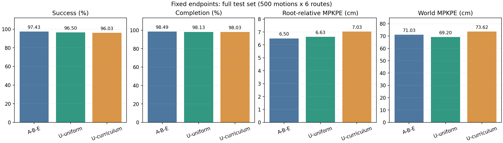
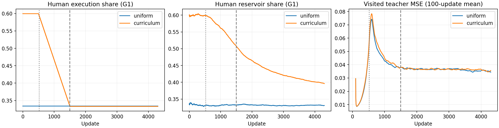

# 联合训练 U：合并 B/E 可学成，但未超过分阶段路线

> [研究总览](00_研究总览.md) · [前因：直接A→B→E有效](04_去除C_A到B到E.md) · [后续：保留阶段分工研究FSQ](07_FSQ命令表征_当前主基线.md)

**研究问题：能否省去独立Human预训练，从随机学生直接学六路？早期多用Human执行是否有帮助？** uniform与curriculum均完成U4300和完整评测，测试成功率 **96.50% / 96.03%**，均低于A→B→E的 **97.43%**，下降区间均低于零。当前继续保留B/E分工。

| 开篇速览 | 本实验 |
|---|---|
| 网络 | 连续MLP共享学生，三来源与执行模块从第一轮一起训练。 |
| 训练 | 复用A，新建学生U4300；两组只改变rollout来源课程，监督始终六路等权。 |

## 1. 网络：所有来源从第一轮共同学习



连续命令/本体编码器512→256、共享512→512→256 MLP、29/21维线性头，结构与原A→B→E相同，无FSQ。两组都从随机学生开始，不加载B/C/E。初始参数逐位相同，独立init_seed=20261006，训练seed0；A教师、critic与标准差冻结。

## 2. 两组唯一的直接对照因素

| 项目 | uniform | curriculum |
|---|---|---|
| 实际执行来源目标比例 | Human/G1/Roban始终各1/3 | 前500轮0.6/0.2/0.2；随后1000轮线性转为各1/3 |
| 监督路由 | 每个状态始终三来源等权 | 相同 |
| 教师接管 | 前20轮全接管，随后500轮衰减，第521轮归零 | 相同 |
| 更新模块 | 三来源编码器、本体编码器、主干、动作头 | 相同 |
| 损失 | 对A教师动作的六路MSE；无固定旧学生保持项、无PPO | 相同 |

来源仅在自然episode重置时按最大缺额分配，保持正在执行的回合不换源。**课程改变哪些来源产生访问状态，没有改变监督损失权重，也不是先冻结后解冻。** 教师全接管期间，来源偏置本身不改变执行动作。

## 3. 固定训练预算

| 项目 | 两组共同设置 |
|---|---|
| 环境、rollout、回放 | 每机型1024环境、16步；32768行uniform reservoir |
| 优化 | Adam；4300轮余弦lr从1e-4降至1e-5；梯度裁剪1 |
| 第1–4000轮 | 每轮32次优化，batch2048/机型 |
| 第4001–4300轮 | 每轮16次优化，batch1024/机型 |
| 每组总量 | 140,902,400 transitions、132,800次优化、534,118,400次回放抽样 |
| 阶段状态 | 全程同一个Student/Adam/reservoir，不在4000轮重置或改学习目标 |

这些计数与原B＋E相同，但U从第一轮就六路监督，学习率、保持项和参数更新安排也不同。因此U之间是来源课程单因素比较，U对B→E是路线级比较；不宣称等FLOPs或等监督标签成本。

## 4. 完整验证和测试

| 划分 / 终点 | 模型 | 成功率 ↑ | 完成比例 ↑ | 根相对误差 ↓ | 世界误差 ↓ |
|---|---|---:|---:|---:|---:|
| 验证 | A→B→E | 96.73% | 98.17% | 6.37 cm | 68.93 cm |
| 验证 | U-uniform | 95.97% | 97.97% | 6.73 cm | 70.44 cm |
| 验证 | U-curriculum | 95.57% | 97.78% | 6.78 cm | 72.52 cm |
| 测试 | A→B→E | 97.43% | 98.49% | 6.50 cm | 71.03 cm |
| 测试 | U-uniform | 96.50% | 98.13% | 6.63 cm | 69.20 cm |
| 测试 | U-curriculum | 96.03% | 98.03% | 7.03 cm | 73.62 cm |



相对A→B→E，uniform测试少28个成功组合，成功率差−0.9333个百分点，95%区间[−1.7112,−0.2155]；curriculum少42个，差−1.4000个百分点，区间[−2.3099,−0.5703]。两组验证成功率也有支持下降的区间。

uniform世界误差点估计较低，但差值区间跨零。curriculum相对uniform成功率差−0.4667个百分点的区间跨零，根相对与世界误差差值区间分别为[+0.0630,+0.8897]cm、[+0.1312,+10.3783]cm，支持课程组精度较差。

| 测试路径 | A→B→E | uniform | curriculum |
|---|---:|---:|---:|
| Human→G1 | 97.2% | 97.2% | 96.2% |
| G1→G1 | 96.8% | 97.0% | 96.2% |
| Roban→G1 | 97.6% | 95.8% | 96.2% |
| Human→Roban | 96.4% | 95.0% | 94.6% |
| G1→Roban | 98.2% | 97.4% | 96.6% |
| Roban→Roban | 98.4% | 96.6% | 96.4% |

uniform较明显的退化集中在Roban来源的两条路径（各−1.8个百分点，区间均低于零）。双方U与基准的测试恢复片段均为0，不能把退化解释为数值恢复事件增加。

## 5. 课程执行了，为什么没有看到收益

实际Human执行比例从约59.96%降至第1500轮的33.31%，课程与接管日程都按设定运行。问题线索在回放分布：全历史reservoir中，Human状态占比在1500轮仍约50.7%/50.8%，4300轮仍约39.6%/39.2%。**当前rollout均衡，不等于回放状态均衡。**



这是可进一步消融的解释，不能单凭相关性认定它造成了退化。独立B不是“能否学成”的绝对必要条件，但当前U配方没有无损替代B→E；也不能把本轮负结果推广到所有课程或联合训练。

如果继续研究，优先在两组都采用相同回放机制的前提下检验来源分层抽样。Human监督权重课程是另一个问题，应另立实验，不能与本次rollout来源课程混为一谈。

## 6. 复现与证据

主终点4300在训练前固定，未按中途或测试表现挑选checkpoint。每划分500动作×六路、验证64环境/测试500环境、seed42，使用相同A及同一参考模型评分。

- [uniform配置](../../cfg/xwbc/v02/unified_uniform.yaml)、[curriculum配置](../../cfg/xwbc/v02/unified_curriculum.yaml)、[训练器](../../scripts/train_xwbc_unified.py)。
- [uniform完整产物](../../logs/v0.2/unified_20261006/uniform/)、[curriculum完整产物](../../logs/v0.2/unified_20261006/curriculum/)。
- [最终复核审计](../../logs/v0.2/unified_20261006/final_review_audit.json)、[两U组直接测试比较](../../logs/v0.2/unified_20261006/curriculum_vs_uniform_test.json)。

```bash
env -u LD_LIBRARY_PATH OMP_NUM_THREADS=4 OPENBLAS_NUM_THREADS=1 \
  .venv/bin/python -u -B scripts/run_xwbc_unified_experiments.py \
  --output logs/v0.2/unified_reproduction
```

两组训练耗时约4.65/4.67小时，受共享GPU影响，不解释为独立任务速度对照。恢复计数、初始化审计、工程短检和逐轮课程指标保留在原目录；本篇集中记录完整实验的设计、证据与判断。
