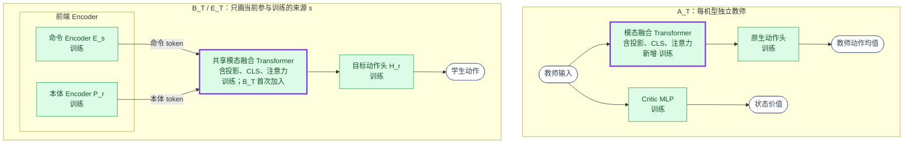
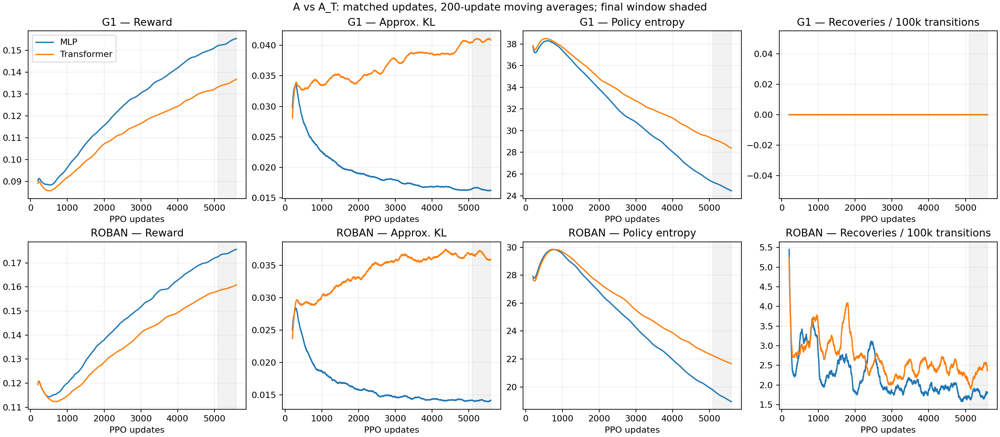

# Transformer 主干：教师可用，但学生 B 完整验证失败

> [研究总览](00_研究总览.md) · [前因：连续MLP的A→B→E基准](04_去除C_A到B到E.md) · [后续：小幅改动命令表征](07_FSQ命令表征_当前主基线.md)

**研究问题：把actor的MLP主干替换为模态融合Transformer，能否改善跨机型共享？** 实际完成A_T10000与B_T2000，两位教师均通过准入；B_T的Human两路平均成功率从原B的 **92.0%降至56.6%**，未通过能力门槛，**E_T没有训练**。这是当前架构和配方的负结果，不是所有Transformer的结论。

| 开篇速览 | 本实验 |
|---|---|
| 网络 | 教师4个/学生3个模态token，2层4头Transformer；没有逐时刻注意力、没有FSQ。 |
| 训练 | 重训A_T10000、B_T2000；B能力失败，原计划E_T2300未执行。 |

## 1. 结构：同时换了教师与学生，不是只换学生



| 部分 | 模态Token如何构成 | 替换范围 |
|---|---|---|
| A_T | 本体历史、特权状态、原生参考各投影一个token，加CLS共4个 | 替换teacher actor MLP；critic保持原MLP |
| B_T / 计划E_T | 保留命令与本体512→256编码器，两输出各一token，加CLS共3个 | 替换共享执行主干，保留29/21维动作头 |
| Transformer块 | d_model256，2层，4头，FFN512，Pre-LN，GELU，残差，dropout0；CLS汇聚 | 可学习模态类型向量，无跨episode缓存 |

这些token是历史展平后的模态向量，没有将每个时刻单独作为token，因此本轮不检验长序列时间注意力。学生使用连续命令表征，没有FSQ。

参数量（含critic）：G1教师8,259,131→5,621,793，Roban教师7,796,267→5,330,513，学生6,710,314→7,241,002；不是等参数对照。

## 2. 训练配方与实际执行边界

| 阶段 | 数据与优化预算 | 训练 / 冻结 | 实际状态 |
|---|---|---|---|
| A_T | 每机型4096×32×10000；PPO 3 epochs，batch8192，lr1e-4；每教师1,310,720,000 transitions | 独立actor、critic、标准差训练 | 两教师完成并准入 |
| B_T | 每机型1024×16×2000；32次监督/轮、batch2048、lr1e-4；合计65,536,000 transitions | Human编码器与执行模块训练；A_T、机器人来源编码器、critic、标准差冻结 | 完成，但能力不通过 |
| E_T（原计划） | 2300轮，前2000轮32×2048，后300轮16×1024，lr1e-5 | 全来源actor训练，固定B_T保持×0.1 | **未执行** |

A_T从头训练；B_T新建随机学生，由冻结A_T在真实访问状态监督。B保留20轮教师启动、500轮衰减，及每机型32768行reservoir。数据、窗口、环境、控制和seed与MLP一致，FLOPs与墙钟不匹配。不能把计划中的E预算写入实际已完成量。

B_T准入沿用成功≥90%、完成≥95%、根相对误差≤10cm、恢复≤1%；不为新架构降低标准。

## 3. 完整验证：应比较同阶段

| 阶段 / 路径 | 成功率 MLP→T | 完成比例 MLP→T | 根相对误差 MLP→T | 世界误差 MLP→T |
|---|---:|---:|---:|---:|
| A：G1原生 | 99.4%→97.6% | 99.70%→99.07% | 4.43→5.39 cm | 33.43→36.21 cm |
| A：Roban原生 | 98.4%→97.6% | 99.09%→98.76% | 3.70→4.56 cm | 39.64→43.78 cm |
| B：Human→G1 | 93.4%→57.6% | 96.85%→79.58% | 8.40→12.76 cm | 86.90→120.83 cm |
| B：Human→Roban | 90.6%→55.6% | 95.69%→77.53% | 8.93→12.14 cm | 92.62→117.23 cm |

每路500动作、83家族、64环境、seed42；B共1000条，成功920→566，差−35.4个百分点，家族配对95%区间[−41.45,−29.34]。两路违反成功、完成、根相对误差三项准入条件，恢复比例仍通过（G1 0→0条、Roban 2→3条）。

退化覆盖所有类别：G1跑步85.61%→31.06%、走路94.68%→64.26%、上身100%→74.29%；Roban对应81.06%→28.79%、93.16%→62.74%、96.19%→71.43%。不是少数恢复事件可以解释的。


## 4. 中途观察与最终解释放在同一条证据链

### 第5600轮的A同期诊断

统一比较5101–5600轮的500轮均值，双方每教师734,003,200 transitions；不把中期A_T与最终MLP混比。Transformer训练奖励落后，G1 0.154270→0.135552、Roban 0.174663→0.160004；KL分别约为MLP的2.50/2.58倍，熵高16.1%/13.9%。曲线仍改善，所以当时继续预登记预算，没有中途改学习率或熵系数。



这段观察提示随机策略探索与更新幅度有差别，但不能单凭训练reward决定最终确定性验证；后来A_T实际通过了准入。同期更短墙钟受参数量与GPU并发影响，也不构成架构加速结论。

### B末期：回放拟合没有转成闭环能力

| 末100轮动作MSE | G1 MLP / T | Roban MLP / T |
|---|---:|---:|
| 回放训练状态 | 0.00658 / 0.00737 | 0.00543 / 0.00591 |
| 当前实际访问状态 | 0.0480 / 0.3485 | 0.0682 / 0.4327 |


接管退出后，Transformer的闭环奖励降低，访问状态误差约为MLP的7.3/6.3倍。该现象提示监督泛化或闭环稳定性问题，但不能直接把原因指定为CLS、reservoir或某个超参数：**教师也变了，双方访问状态和标签并不相同。**

## 5. 判断与后续边界

保留这次失败，继续用MLP主干作为当前路线基础。若再次研究Transformer，优先固定原MLP A教师、仅换学生主干，再分别研究融合与时序结构、回放分布和超参数。强行从弱B_T继续E_T将是新的实验，不能写成本轮已通过准入。

## 6. 复现与证据

- [Transformer配置](../../cfg/xwbc/v02/staged_transformer.yaml)、[原计划E配置](../../cfg/xwbc/v02/refinement_transformer.yaml)、[模型](../../active_adaptation/learning/modules/xwbc_transformer.py)。
- [完整实验目录](../../logs/v0.2/transformer_20261006/)、[实际停止原因](../../logs/v0.2/transformer_20261006/pipeline_failure.json)。
- [同阶段B比较](../../logs/v0.2/transformer_20261006/final_analysis/student_human_comparison.json)、[原始评分审计](../../logs/v0.2/transformer_20261006/final_analysis/score_audit.json)。
- [5600轮统计](analysis/transformer_20261006/analysis_5600/comparison.json)、[生成脚本](analysis/transformer_20261006/analysis_5600/compare_training.py)。该脚本保留原日志路径；指标快照在原日志目录，不能误称已全部复制到analysis。

```bash
env -u LD_LIBRARY_PATH OMP_NUM_THREADS=4 OPENBLAS_NUM_THREADS=1 \
  .venv/bin/python -u -B scripts/run_xwbc_transformer.py \
  --output logs/v0.2/transformer_reproduction
```

工程审计覆盖checkpoint、阶段身份、冻结范围、预算与评分一致性；通过这些检查不等于排除了全部潜在实现问题。以上是一个训练种子、一个具体模态融合方案的结果。
