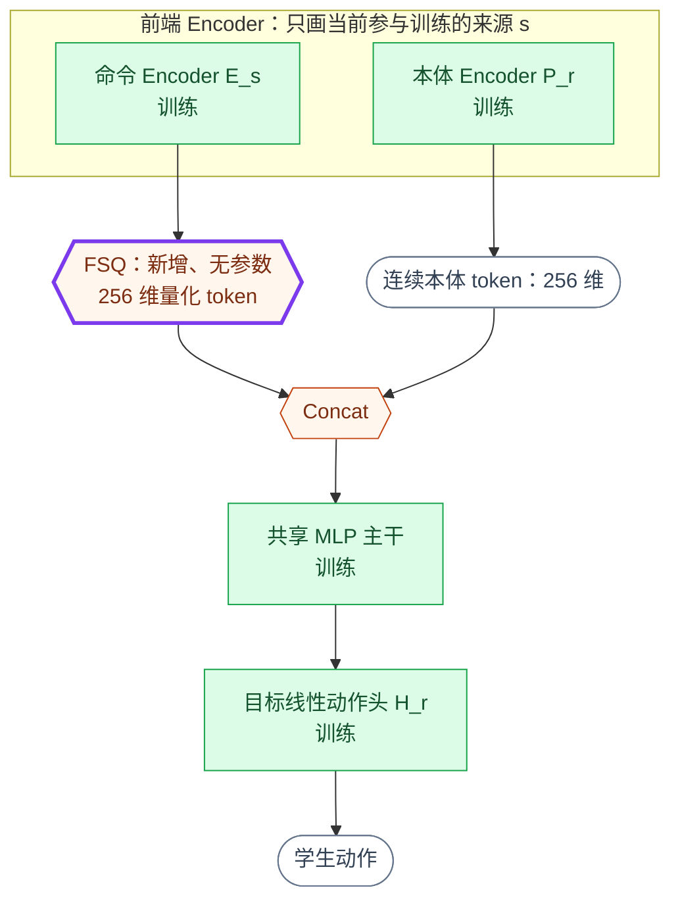

# FSQ 命令表征：当前采用的 A→B→E 主基线

> [研究总览](00_研究总览.md) · [前因：连续表征A→B→E](04_去除C_A到B到E.md) · [后续：机型条件动作解码](08_FlowMatching与MLP动作解码.md)

**研究问题：只把学生命令token离散化，能否在保留A→B→E配方时改善控制？** 完整测试成功率 **97.43%→97.83%**，四项总体点估计均改善；验证成功率略降、根相对精度退化。测试差值区间均跨零，尚未确立稳定优越性。

**当前研究决策：选用FSQ版作为后续主基线，连续版作为必要对照。** 这是结合完成能力、实现成本与后续研究方向作出的选择，不把“选作基线”写成“统计上已全面胜出”。

| 开篇速览 | 本实验 |
|---|---|
| 网络 | 三种命令编码器尾部增加无参数FSQ；256维不变，本体与共享MLP仍连续。 |
| 训练 | 复用A，重训B2000→E2300；其余配方沿用直接E基准。 |

## 1. 网络：量化只放在命令编码器末端



每个来源编码器为LayerNorm→512→ELU→256→ELU→FSQ；三种来源各自编码器参数独立，但量化规则相同。目标本体编码器仍是连续512→256，拼接后经过共享512→512→256 MLP与G1/Roban 29/21维线性头。

`u = 4.499549865722656 × tanh(z)`，前向输出`round(u)`，反向使用u的梯度（STE）。无新增参数、投影、码本学习、commitment loss或token对齐损失。原末层ELU保留，因此**量化器理论范围为−4…4，实际编码器可达级别为−3…4，共8级**。

这是一项256维逐标量量化实验，不是压缩为低维动作词表；它同时引入限幅、缩放和取整，不能单独把收益归因于round。实现依据仓库已有[StudentLatentQuantizer](../../active_adaptation/learning/modules/student_latent_quantizer.py)；[FSQ原论文](https://arxiv.org/abs/2309.15505)作为方法背景。先前核对的HEFT正文未检索到该量化描述，因此不将本配置称为HEFT论文参数的严格复现。

## 2. 训练：A原样复用，B/E重新开始

| 阶段 | 初始化与监督 | 更新范围 | 固定预算 |
|---|---|---|---|
| A | 复用原两份最终教师，不重训 | 冻结 | 共同成本 |
| B_FSQ | 新建随机学生；Human两路教师动作MSE；20轮启动、500轮接管衰减 | Human编码器＋本体编码器＋主干＋动作头 | 2000轮、lr1e-4；32次×batch2048/机型 |
| E_FSQ | 从本次B开始，新Adam与空reservoir；六路教师MSE＋0.1×冻结本次B的同来源保持 | 所有actor模块 | 2300轮、lr1e-5；前2000轮32×2048，末300轮16×1024 |

每机型1024环境、rollout16、reservoir32768、seed0。B/E合计140,902,400 transitions、132,800次优化、534,118,400次回放抽样；critic、log_std、教师冻结。E纯学生执行，无PPO、无接管。初始参数键与默认网络兼容，FSQ配置保存于constructor，训练、anchor与评估一致恢复。

## 3. B和最终E分别告诉我们什么

B2000平均成功率92.0%→93.7%，完成96.27%→96.81%；根相对误差8.67→9.76cm，世界误差89.76→97.87cm。Human→G1/Roban成功率为94.2%/93.2%，通过既定能力准入，但有精度代价。

| 划分 / 终点 | 模型 | 成功率 ↑ | 完成比例 ↑ | 根相对误差 ↓ | 世界误差 ↓ |
|---|---|---:|---:|---:|---:|
| 验证E2300 | 连续表征 | 96.73% | 98.17% | 6.37 cm | 68.93 cm |
| 验证E2300 | FSQ | 96.43% | 97.94% | 6.70 cm | 70.19 cm |
| 测试E2300 | 连续表征 | 97.43% | 98.49% | 6.50 cm | 71.03 cm |
| 测试E2300 | FSQ | 97.83% | 98.76% | 6.47 cm | 68.80 cm |

| E测试差值（FSQ−连续版） | 点估计 | 家族配对95%区间 |
|---|---:|---:|
| 成功率 | +0.4000个百分点 | [−0.3321,+1.2491] |
| 完成比例 | +0.2718个百分点 | [−0.1285,+0.7477] |
| 根相对误差 | −0.0329 cm | [−0.2030,+0.1405] cm |
| 世界误差 | −2.2206 cm | [−4.7930,+0.3530] cm |

测试成功组合2923→2935，净增12。四项区间均跨零，不能认定稳定改善，也不能认定等效。验证成功组合2902→2893；根相对误差增加0.3339cm，区间[+0.0037,+0.7135]cm，支持该验证集精度退化。

| 测试路径 | 连续版成功率 | FSQ成功率 | 差值 |
|---|---:|---:|---:|
| Human→G1 | 97.2% | 98.0% | +0.8个百分点 |
| G1→G1 | 96.8% | 98.0% | +1.2个百分点 |
| Roban→G1 | 97.6% | 97.0% | −0.6个百分点 |
| Human→Roban | 96.4% | 96.2% | −0.2个百分点 |
| G1→Roban | 98.2% | 98.8% | +0.6个百分点 |
| Roban→Roban | 98.4% | 99.0% | +0.6个百分点 |

测试双方恢复片段均为0；验证双方G1三路为0、Roban三路各2。收益方向在划分与路径间并不一致，因此不能解释为全面更稳。

## 4. 为什么仍选择它作为主线

它在既定预算内完成六路学习，没有新增可训练参数，测试完成指标点估计较好；按当前以控制成功和后续研究为优先的目标，可以采用它继续做结构实验。同时保留连续版，后续方法应报告相对两者的表现，防止基线选择掩盖退化。

还未回答的问题是：收益来自取整还是tanh限幅/缩放？更多种子是否方向一致？是否改善噪声命令或新机型？下一轮若定位机制，优先增加同尺度tanh但不取整的对照、配对训练种子以及明确的命令扰动实验。离散化本身不自动证明语义对齐、抗噪或动作平滑。

## 5. 复现与证据

主终点E2300在训练前固定，验证64环境、测试500环境、seed42，每划分3000条。原始评分、教师身份、冻结参数、实际终点及环境一致性审计通过。E训练2300轮耗时6900.69秒；67项CPU回归、双机型B/E短训练与六路评分接口检查通过，工程检查不代替性能验证。

- [B配置](../../cfg/xwbc/v02/staged_fsq.yaml)、[E配置](../../cfg/xwbc/v02/refinement_fsq.yaml)、[自动队列](../../scripts/run_xwbc_fsq.py)。
- [固定E2300权重](../../logs/v0.2/fsq_20261007/run01/E_FSQ/checkpoint_2300.pt)、[预登记](../../logs/v0.2/fsq_20261007/run01/protocol.json)。
- [B对照](../../logs/v0.2/fsq_20261007/run01/student_human/comparison_val.json)、[E验证比较](../../logs/v0.2/fsq_20261007/run01/E_FSQ/comparison_val.json)、[E测试比较](../../logs/v0.2/fsq_20261007/run01/E_FSQ/comparison_test.json)。
- [验证原始评分审计](../../logs/v0.2/fsq_20261007/run01/E_FSQ/eval_val_2300/independent_score_audit.json)、[测试审计](../../logs/v0.2/fsq_20261007/run01/E_FSQ/eval_test_2300/independent_score_audit.json)、[完整完成记录](../../logs/v0.2/fsq_20261007/run01/pipeline_result.json)。

```bash
env -u LD_LIBRARY_PATH OMP_NUM_THREADS=4 OPENBLAS_NUM_THREADS=1 \
  .venv/bin/python -u -B scripts/run_xwbc_fsq.py \
  --output logs/v0.2/fsq_reproduction/run01
```

已有曲线曾在本机6013端口提供。服务是否仍运行与实验是否完成是两回事；长期可复查依据是上述权重、配置与评分文件。
