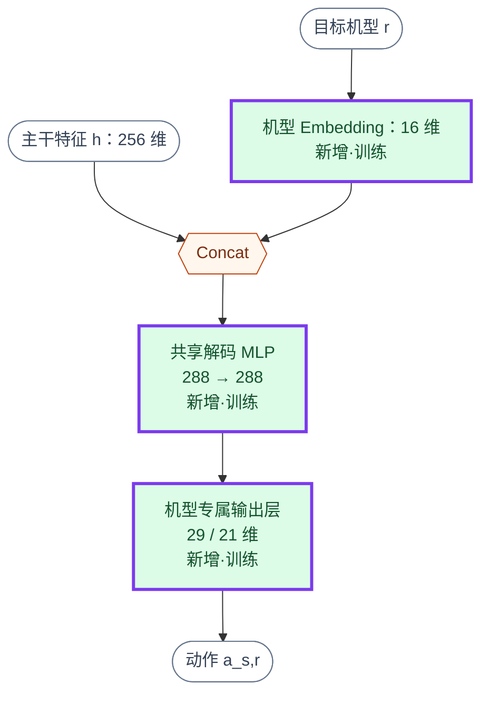
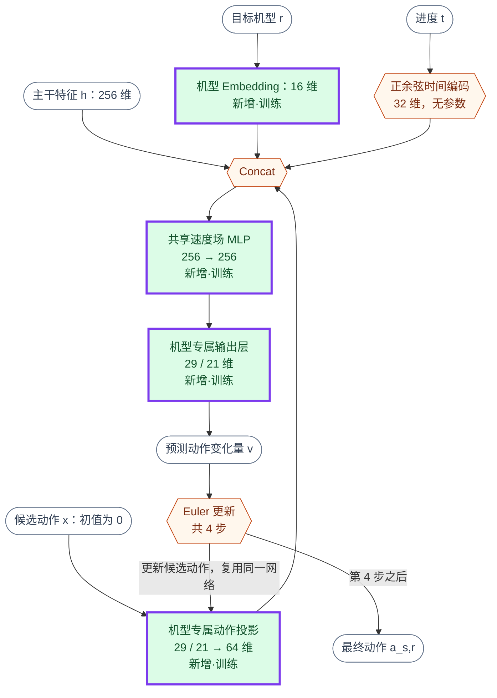

# Flow Matching 与容量匹配 MLP：完整结果与积分步数诊断

> [研究总览](00_研究总览.md) · [前因：FSQ主基线](07_FSQ命令表征_当前主基线.md)

**研究问题：保留FSQ与共享主干，机型条件的4步流式动作解码，是否优于同等容量的直接动作回归？** 两组B2000均通过完整验证；FLOW / MLP平均成功率 **94.80% / 94.10%**，根相对误差 **7.93 / 8.85 cm**。目前最明确的积极证据是FM的跟踪精度改善，成功率优势区间仍跨零。

**本轮两组训练、完整验证/测试与1/2/8步诊断均已完成。** 4步FM测试成功率97.60%，原FSQ为97.83%，四项差异区间均跨零，未替换FSQ主基线；FM相对容量MLP的动作变化更小。后续[教师续训与8步增量微调](09_教师续训与8步FM增量微调.md)作为新实验单独登记。

| 开篇速览 | 本实验 |
|---|---|
| 网络 | 保留FSQ与共享MLP，机型条件解码：MLP288×2 vs FLOW256×2、零初值4步。 |
| 训练 | 两组各复用A、重训B2000→E2300；B均通过，两组E2300完整评测及步数诊断已完成。 |

## 1. 网络：前端不变，只换动作解码

共同前端为三种512→256命令编码器＋原FSQ、两种连续本体编码器、共享512→512→256 MLP，得到256维控制特征h。两组都复用原A，从B新建学生；不从FSQ E权重微调。

### 容量匹配的直接回归 MLP



### Flow Matching 的实际执行路径



| 项目 | 增强MLP | FLOW |
|---|---|---|
| 条件 | h＋16维机型embedding | 同左；另加候选动作64维投影、32维时间编码 |
| 共享解码层 | 288→288，ELU | 256→256，ELU速度场 |
| 机型专属接口 | 29/21维输出 | 29/21维候选动作输入投影与输出 |
| 解码器参数 | 176,338 | 176,466 |
| 全模型参数（含critic） | 6,873,802 | 6,873,930 |
| 执行方式 | 一次回归 | 零初值，4步Euler，最终执行一次 |

只相差128个参数（解码器约0.073%）。实际保存的两组公共初始权重逐位相同。机型动作在各自空间中学习，不把G1关节向量直接插值成Roban关节向量。编码器/共享特征每个20ms控制周期只计算一次，重复的是小解码器。

## 2. FLOW到底学什么

对应A教师在学生实际访问状态给出动作均值a_T。训练取 `ε~N(0,I)`、`τ~U[0,1)`，构造：

```text
x_τ = (1−τ) ε + τ a_T
目标速度 = a_T − ε
L_FM = mean_valid_action_dims [v_θ(x_τ, τ, h, robot) − (a_T−ε)]²
```

教师标签detach，不作为部署条件。τ是生成时间，不是仿真物理时间。FM噪声和时间由独立设备RNG产生并随checkpoint保存，不改变仿真全局随机流。

训练、验证和实际rollout都从零初值积分4步生成执行动作；只有计算FM监督损失时采样高斯噪声。零初值终点不等于流分布的数学均值，旧高斯actor接口对FLOW显式拒绝，使用分阶段确定性执行接口。

参考[Flow Matching](https://arxiv.org/abs/2210.02747)、[π₀](https://arxiv.org/abs/2410.24164)和[机器人流策略的zero-sampling](https://arxiv.org/html/2602.02481v1#S3.SS4)。本轮仍是监督蒸馏，不实现FPO++强化学习，不预设已有单标签数据具备多模态优势。

## 3. B→E配方与对照约束

| 阶段 | MLP目标 | FLOW目标 | 训练范围与预算 |
|---|---|---|---|
| A | 原两教师冻结复用 | 相同 | 不重训 |
| B2000 | Human两路动作MSE | Human两路FM MSE | Human编码器＋本体编码器＋主干＋解码器；lr1e-4，32×2048/机型；教师接管20轮后500轮衰减 |
| E2300 | 六路动作MSE＋0.1同来源冻结B保持 | 六路FM MSE＋0.1积分后动作对冻结B_FLOW的保持 | 全actor；lr1e-5，前2000轮32×2048、末300轮16×1024；纯学生执行 |

E从各自B权重初始化，新Adam与空reservoir。保持项使用同一状态、同一来源，FLOW的梯度贯穿学生4步积分；anchor完全冻结。FM教师项与动作保持项作用于不同对象，0.1不代表与旧损失完全相同的有效正则强度。

每组seed0、每机型1024环境×16步，reservoir32768；B＋E合计140,902,400 transitions、132,800次优化、534,118,400次回放抽样。critic、标准差、A及E的固定B参照均冻结，无PPO。参数接近不等于计算量相同；两组并行共享B200，墙钟受竞争影响。

## 4. B2000完整验证：精度收益比成功率证据更强

| 划分 / 终点 | 模型 | 成功率 ↑ | 完成比例 ↑ | 根相对误差 ↓ | 世界误差 ↓ |
|---|---|---:|---:|---:|---:|
| 验证B2000 | 原FSQ | 93.70% | 96.81% | 9.76 cm | 97.87 cm |
| 验证B2000 | 增强MLP | 94.10% | 97.06% | 8.85 cm | 93.14 cm |
| 验证B2000 | FLOW | 94.80% | 97.22% | 7.93 cm | 87.77 cm |

| Human路径成功率 | 原FSQ | 增强MLP | FLOW |
|---|---:|---:|---:|
| →G1 | 94.2% | 95.4% | 95.6% |
| →Roban | 93.2% | 92.8% | 94.0% |

每路500动作、83家族，验证64环境、seed42；两新组恢复片段均为G1 0、Roban 2。通过既定能力准入，未放宽门槛。

FLOW相对容量匹配MLP的根相对误差降低 **0.92cm（约10.4%）**，家族配对95%区间 **[−1.32,−0.54]cm**；成功率差+0.7个百分点的区间为[−0.59,+1.96]，跨零。世界误差差值区间也跨零。相对原FSQ，FLOW两类误差下降均获区间支持。这里比较的是同一B终点，不是与原E比较。[两新组直接配对统计](analysis/restructure_20261007/fm_vs_mlp_B_val.json)在本次整理时只读重算，共1000条记录。

### 动作变化、训练与计算代价

- 完整验证轨迹的实际PD目标相邻步变化RMS：G1，MLP 0.13325→FLOW 0.11000 rad；Roban，0.16231→0.13924 rad，分别下降约17.4%/14.2%。双方访问状态不同，这支持更平缓的观察，但不是固定状态因果消融。
- B末100轮FM流损失与endpoint动作MSE仍下降；所有指标有限、冻结参数和教师审计通过。训练恢复累计FLOW为0/684，MLP为0/706，不能替代验证恢复片段。
- 服务器CPU合成输入下，含编码器/主干的batch1平均延迟：FLOW约0.68–0.73ms，MLP约0.33–0.34ms。不是机器人端的部署测量，也不是独占GPU速度结论。
- 合成输入的16种噪声初值敏感性检查单独记录，不能当作真实任务的多模态质量评分。主执行始终使用零初值。

`flow_mse`衡量训练向量场；B的`action_mse`、E的`teacher_mse`衡量积分后动作。只有流损失下降不足以证明控制改善。

## 5. E完整结果与积分步数诊断

固定E2300、4步FM主配置，验证64环境、测试500环境、seed42，每模型每划分3000条。两组完整预算、原始评分、实际终点和环境一致性审计通过。以下结果于2026-10-08核对。

| 完整测试 | 成功率 | 完成比例 | 根相对误差 | 世界误差 |
|---|---:|---:|---:|---:|
| 原FSQ | 97.83% | 98.76% | 6.47 cm | 68.80 cm |
| 增强MLP | 97.27% | 98.40% | 6.78 cm | 71.18 cm |
| 4步FM | 97.60% | 98.60% | 6.65 cm | 72.55 cm |

4步FM相对FSQ成功率低0.2333个百分点（净少7个成功组合），家族95%区间[−0.8639,+0.2976]个百分点；完成比例、两类误差差值区间也跨零。相对增强MLP，成功率高0.3333个百分点，根相对误差稍低、世界误差更高，测试四项区间也均跨零。B阶段较强的精度优势没有在最终测试上保持同样强度；验证仍支持FM相对MLP的根相对精度改善。

相比容量MLP，FM实际PD目标相邻步变化RMS在验证六路均降低约7%–16%，测试六路均降低约10%–20%。这是各自闭环轨迹上的观察，不等于已证明能耗或真机稳定性改善；原FSQ没有同口径平滑性记录。服务器CPU合成输入batch1平均延迟FM约0.65–0.85ms、MLP约0.35ms，不能外推机器人部署硬件。

### 同一权重的完整验证：步数不是越多必然越好

| FM积分步数 | 成功率 | 完成比例 | 根相对误差 | 世界误差 |
|---|---:|---:|---:|---:|
| 1 | 96.53% | 98.22% | 7.12 cm | 73.89 cm |
| 2 | 96.93% | 98.30% | 6.57 cm | 68.39 cm |
| 4（主配置） | 96.67% | 98.32% | 6.74 cm | 72.35 cm |
| 8 | 97.33% | 98.52% | 6.55 cm | 67.67 cm |

8步相对4步在成功率、根相对与世界误差上的配对区间支持改善；相对原FSQ，成功率、完成比例与世界误差有支持改善的区间。2步部分指标优于4步，表现并不单调。它们是预登记的验证诊断，没有对应测试，不能将8步改称本轮测试赢家；后续固定8步的新实验需独立评估。

末200轮训练指标有限、访问状态误差基本进入平台，部分回放动作误差小幅回升。当前选择是保留FSQ主基线，把教师增强和8步微调作为新问题；不由低FM loss或更多计算量直接推断控制收益。

## 6. 运行入口与证据

- [FLOW B配置](../../cfg/xwbc/v02/staged_flow.yaml)、[E配置](../../cfg/xwbc/v02/refinement_flow.yaml)；[MLP B配置](../../cfg/xwbc/v02/staged_decoder_mlp.yaml)、[E配置](../../cfg/xwbc/v02/refinement_decoder_mlp.yaml)。
- [动作解码器](../../active_adaptation/learning/modules/xwbc_action_decoder.py)、[双组队列](../../scripts/run_xwbc_flow.py)、[解码器审计](../../scripts/audit_xwbc_action_decoder.py)。
- [正式预登记](../../logs/v0.2/action_decoder_20261007/formal/protocol.json)、[参数匹配检查](../../logs/v0.2/action_decoder_20261007/formal/design_check.json)、[实际初始化核验](../../logs/v0.2/action_decoder_20261007/formal.startup_check.json)。
- [FLOW B完整结果](../../logs/v0.2/action_decoder_20261007/formal/flow/student_human/)、[MLP B完整结果](../../logs/v0.2/action_decoder_20261007/formal/decoder_mlp/student_human/)。各目录的`comparison_val.json`是相对原FSQ B，不是两新组直接比较。
- [FLOW当前E目录](../../logs/v0.2/action_decoder_20261007/formal/flow/E_FLOW/)、[MLP当前E目录](../../logs/v0.2/action_decoder_20261007/formal/decoder_mlp/E_MLP/)。完整评分产生后保存在各自`eval_val_2300`、`eval_test_2300`；原始重构快照不代表当前状态。
- [76项CPU回归与双组短检](../../logs/v0.2/action_decoder_20261007/preparation/)、[研究重构时的证据快照](analysis/restructure_20261007/summary.json)。

TensorBoard：[本机6014](http://127.0.0.1:6014/#scalars)，远程IDE转发6014。选择`FM_B/.`、`FM_E/.`、`MLP_B/.`、`MLP_E/.`，已有参考为`FSQ_B/.`与`FSQ_E/.`。服务不是永久证据，最终以运行产物为准。

```bash
env -u LD_LIBRARY_PATH OMP_NUM_THREADS=4 OPENBLAS_NUM_THREADS=1 \
  .venv/bin/python -u -B scripts/run_xwbc_flow.py \
  --output logs/v0.2/action_decoder_reproduction/formal
```

本实验已经完成；新的教师续训与学生增量结果记录在第09篇。
