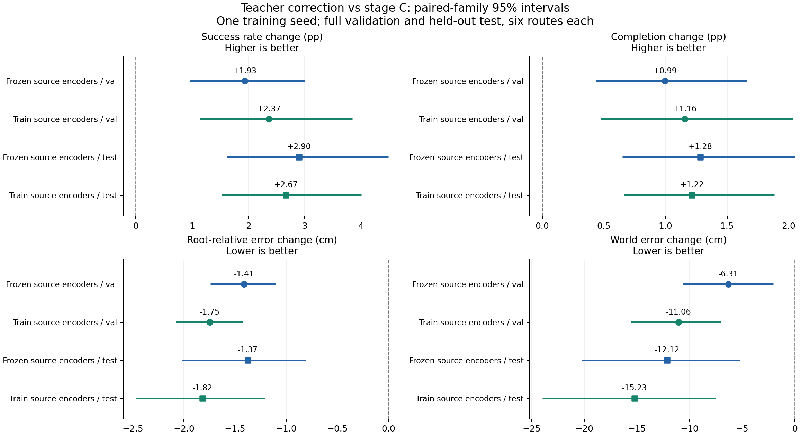

# 教师纠偏：完整验证与独立测试结论

日期：2026-10-05（北京时间）。最终模型在查看测试性能前按验证结果锁定。

本轮已得到在独立测试集上超过 v0.2 C 的共享学生。保持原架构、输入、控制、奖励和数据版本，从 C 继续做六路教师动作纠偏，最终采用三个来源编码器与执行模块共同更新的第300轮模型。

## 主要结果

验证每模型为500动作、83家族×六路；测试每模型为500动作、93家族×六路。下表每个总分均覆盖完整3000条路由—动作记录。

| 划分 | 模型 | 成功率 | 完成比例 | 根相对 MPKPE | 世界 MPKPE |
|---|---|---:|---:|---:|---:|
| 验证 | C | 93.50% | 96.70% | 8.71 cm | 88.82 cm |
| 验证 | 最终学生 | 95.87% | 97.85% | 6.96 cm | 77.77 cm |
| 测试 | C | 93.33% | 96.70% | 8.75 cm | 90.63 cm |
| 测试 | 最终学生 | 96.00% | 97.91% | 6.94 cm | 75.40 cm |

测试集成功组合从2800增加到2880，净增80个；平均成功率提高2.67个百分点，根相对误差降低20.77%，世界误差降低16.80%。测试六路的成功率、完成比例和两类误差点估计均改善，C与最终学生的数值恢复片段均为0。

## 独立测试逐路结果

| 路径 | 成功率 C → 学生 | 完成比例 C → 学生 | 根相对误差 C → 学生 | 世界误差 C → 学生 |
|---|---:|---:|---:|---:|
| human->g1 | 92.8% → 95.2% | 96.78% → 97.46% | 8.70 → 7.59 cm | 82.79 → 71.84 cm |
| g1->g1 | 94.2% → 97.2% | 96.99% → 98.32% | 8.44 → 6.93 cm | 84.78 → 67.89 cm |
| roban->g1 | 95.8% → 96.2% | 97.66% → 97.94% | 8.19 → 6.68 cm | 78.32 → 63.70 cm |
| human->roban | 89.8% → 94.8% | 94.94% → 97.53% | 8.78 → 7.65 cm | 103.34 → 90.47 cm |
| g1->roban | 94.0% → 95.6% | 96.97% → 97.85% | 9.39 → 6.52 cm | 102.72 → 79.11 cm |
| roban->roban | 93.4% → 97.0% | 96.85% → 98.38% | 9.03 → 6.25 cm | 91.84 → 79.42 cm |

## 统计证据与取舍

按动作家族配对重采样10,000次，测试平均差值的95%区间：成功率[1.53, 4.01]个百分点；完成比例[0.66, 1.88]个百分点；根相对误差[-2.47, -1.21] cm；世界误差[-23.99, -7.49] cm。四项区间均支持改善。

同一家族的动作变体和六路记录一起重采样；误差先按各路有效步数加权，再对六路等权平均，提前失败的有效步仍计入。部分单路成功率区间跨零，结论不表述为每一路均有显著成功率提升。区间只刻画当前训练种子的家族抽样不确定性。

冻结来源编码器的第300轮对照也通过独立测试：成功率96.23%、完成比例97.98%、根相对误差7.38 cm、世界误差78.51 cm。最终候选成功率为96.00%，两类误差更低；保持测试前的验证选择，不按测试分数改选。解除来源冻结相对冻结对照的验证成功率增量区间跨零，而两类误差差值区间支持额外精度改善。

首轮第200轮验证成功率更高，但G1→Roban恢复片段由2增至3，按预设恢复不增加条件未入选。所有候选、原始评分与这个取舍均保留。最终候选验证中Human→G1世界误差增加2.72 cm，其他五路下降；测试中该路也改善。



## 有效训练方式

- 从原C初始化；学生独立执行，两个冻结原生教师在同一实际状态上提供动作均值标签，教师接管为零。
- 训练三个命令来源编码器、本体编码器、共享主干和动作头；critic与策略标准差冻结。评估只使用学生原有输入。
- 每路损失为教师动作MSE＋0.1×冻结C动作MSE，按有效动作维度、三来源和两机型等权。等价的输出监督目标约为90.9%教师动作＋9.1%C动作。
- 不使用PPO或价值更新；本轮E阶段仅使用动作监督，继承配置里的A/B/C专用字段不参与E损失。
- Adam学习率1e-5；每机型1024环境、rollout 16步；每轮16次监督优化、batch 1024、每机型32768行reservoir。
- 最终候选追加300轮、9,830,400 transitions。本次两组探索训练共19,660,800 transitions；既有教师训练成本和评估成本另计。

这个结果支持以教师动作监督继续改进统一学生。保持项、学习率等分量尚未分别消融，不能把全部收益单独归因于某一项。

## 公平性与工程核验

训练/验证/测试分别含4000/500/500动作、656/83/93家族，家族交集为空。验证保留64并行环境，与原C验证环境JSON逐值一致；测试预先设定为双方均500并行环境，重新评估C并共享这份完整测试基线。比较始终在同一划分、同一动作集合及同一批量配置内进行。

实际候选文件、父C与教师、数据摘要、构造参数、冻结参数及代码快照通过审计；原始逐片段评分独立重算与汇总一致。40项CPU回归通过。C旧公共学习文件的差异仅是既有PPO采样记录增加old_mean/completed字段；本次训练未调用该PPO采集器。环境、数据读取、策略结构哈希一致，评分数值主体与公共汇总函数AST一致。测试新增的元数据仅标明验证基线归属，不改变评分。

测试目录的gate用于“验证集阶段准入”，因此split=test会出现full_validation_required；测试质量结论取自同测试集的C—候选配对比较及独立审计，不把该准入标志当成测试性能判定。

## 权重与证据

- [最终学生权重](../../logs/v0.2/refinement_20261005/all_sources_run01/checkpoint_300.pt)
- [验证选模锁定记录](../../logs/v0.2/refinement_20261005/final_selection.json)
- [完整验证配对比较](../../logs/v0.2/refinement_20261005/all_sources_run01/comparison_val_300.json)
- [完整测试配对比较](../../logs/v0.2/refinement_20261005/all_sources_run01/comparison_test.json)
- [最终测试审计](../../logs/v0.2/refinement_20261005/final_test_audit.json)
- [评分及分析代码出处](../../logs/v0.2/refinement_20261005/analysis_provenance.json)
- [实验过程、负结果与调度记录](08_教师纠偏训练探索.md)

权重SHA256：`cb40a0e01293f15f024dd798f0f3745c26adb08d6fba01bab4cc09adf47058e5`。原C与教师文件保持原样。

## 复现入口

在HEFT_XWBC_v0.2根目录，使用一个新的输出目录：

```bash
env -u LD_LIBRARY_PATH OMP_NUM_THREADS=4 OPENBLAS_NUM_THREADS=1 \
  .venv/bin/python -u -B scripts/run_xwbc_refinement_variant.py \
  --config cfg/xwbc/v02/teacher_refinement_all_sources.yaml \
  --output logs/v0.2/refinement_reproduction_seed0 \
  --eval-iterations 300 --test-num-envs 500
```

该入口复用现有C及两个教师，训练后完整验证，达到预设联合条件再做测试；已有输出目录会被拒绝覆盖。配置、代码快照、父权重摘要与完整日志随运行保存。

## 结论范围

结论适用于当前简单5K数据、已见G1/Roban、离线参考跟踪、无负载无扰动仿真和一个训练种子。参考窗口含未来400ms采样点；世界误差仍为几十厘米量级。新机型、高难动作、严格在线命令、真机及共享相对独立策略的收益需要各自的实验。
