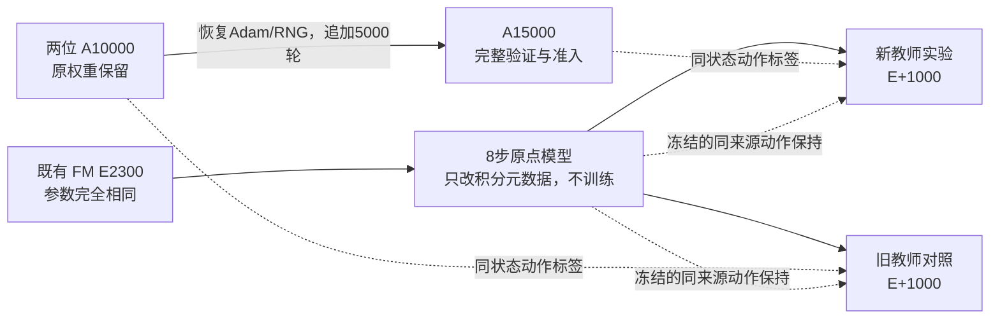

# 教师续训与8步FM增量微调：区分更长训练与更新教师的收益

> [研究总览](00_研究总览.md) · [前因：FM动作解码实验](08_FlowMatching与MLP动作解码.md)

**研究问题：将两位A教师从10000轮续训到15000轮，能否进一步改善已经学成的FSQ＋共享MLP＋FM学生？** 本轮以同一份FM E2300为学生起点，将实际执行统一为8步；分别由A10000和A15000监督，各微调1000轮。原点8步策略作为不训练参照。**全部训练与完整评测已完成：教师跟踪精度明确改善，但新教师没有带来明确的学生整体收益。** 旧/新教师学生测试成功率为 **98.00% / 97.27%**，根相对误差 **6.25 / 6.13cm**；本轮保留旧教师微调版本为候选，新教师版本作为精度取舍对照，未自动替换FSQ主基线。

| 开篇速览 | 本实验 |
|---|---|
| 网络 | A保持原MLP教师；学生保留FSQ、共享MLP及原FM参数，仅将积分由4步固定改为8步 |
| 教师训练 | 恢复A10000的权重、Adam和全部随机状态，各追加5000轮PPO，累计终点15000 |
| 学生训练 | 同一E2300权重，新Adam、空reservoir、新流训练RNG；两组各追加1000轮六路监督 |
| 对照因素 | 两学生组只改变原生教师的训练终点；相同8步推理、预算、保持目标和初始化 |

## 1. 实验结构与权重来源



学生结构仍为三种512→256命令编码器＋FSQ、两种连续本体编码器、共享512→512→256主干、机型条件FM解码器（共享256→256，G1/Roban输出29/21维）。每个控制周期只算一次条件特征，小解码器零初值Euler迭代8次，最终执行一个动作。

8步原点权重由已登记的4步E2300导出，模型张量不变；记录原检查点SHA和参数摘要，只更改constructor/config中的步数。它是推理设置转换，不是假装已有额外训练，也不恢复原E优化器。

A10000终点来自 `staged_run01/teacher_{g1,roban}/checkpoint_final.pt`。学生起点来自 `action_decoder_20261007/formal/flow/E_FLOW/checkpoint_2300.pt`。正式教师绝不使用本轮工程短检更新后的权重初始化。

## 2. 为什么做这次增量

A末期训练奖励仍上升：G1第7001–7500轮均值0.16668，第9501–10000轮0.17622；Roban为0.18598→0.19568，KL与数值恢复未明显恶化。但策略熵也在下降，不能由训练reward保证确定性验证改善。

A10000验证成功率已为99.4%/98.4%，根相对误差4.43/3.70cm。学生8步原生路径的根相对误差约6.24/6.34cm，仍有差距；更强教师、学生可见信息、蒸馏目标和回放分布都可能影响该差距，不能预先认定教师是唯一瓶颈。

上一轮8步验证有积极信号，因此在新实验开始前固定8步。上一轮的主结果仍是4步，不回写或重选旧实验结论。

## 3. 固定预算与训练/冻结范围

### A：真正恢复训练状态

| 项目 | 每位教师 |
|---|---|
| 累计轮次 | 10000→15000，新增5000；不是从头训练15000 |
| 采样 | 4096环境×rollout32，新增655,360,000 transitions |
| 优化 | Adam lr1e-4，3 epochs，minibatch8192；新增240,000次优化 |
| PPO配方 | clip0.2、entropy0.005、value0.5、梯度裁剪1、seed0，与A原配方一致 |
| 模块 | actor、critic、log_std继续更新；每机型独立网络与优化器 |
| 检查点 | 每1000轮保存；额外保存恢复后的起始checkpoint以核验Adam/RNG逐项相同 |

两教师合计新增1,310,720,000 transitions。恢复学习器状态后，仿真回合重新开始，不声称精确恢复保存瞬间的物理状态。累计计数与本次新增计数分别记录。

### E增量：同起点、同预算，只换教师

| 项目 | A10000_control | A15000_candidate |
|---|---|---|
| 学生起点 | 同一8步E2300推理快照 | 相同 |
| 教师 | 冻结A10000 | 冻结并通过完整准入的A15000 |
| 保持模型 | 冻结起始E2300，按8步计算同来源动作 | 相同 |
| 训练参数 | 所有来源编码器、本体编码器、主干、FM解码器 | 相同 |
| 冻结参数 | critic、标准差、教师、起始E参照 | 相同 |
| 预算 | 1000轮，1024环境/机型，rollout16 | 相同 |
| 优化 | Adam lr1e-5，16次/轮，batch1024/机型，裁剪1 | 相同 |
| 初始化状态 | 新Adam、空32768行reservoir/机型、新流噪声RNG | 相同 |
| 损失 | FM向量场MSE＋0.1×实际8步动作对冻结起始E的MSE | 相同 |

每学生组新增32,768,000 transitions、16,000次优化、32,768,000次回放状态抽样。教师始终在学生真实访问状态上提供均值动作标签；纯学生执行，无PPO、无教师接管。新教师组不混入A10000生成的历史标签。新增阶段轮次为1–1000，父阶段E2300在血缘字段明确记录。

保持项从旧B改为起始E，是两组共同的增量配方变化，不把整体微调收益全部归因于教师。系数0.1预先固定，后续若调整须另立对照。

## 4. 队列与固定评测

1. 先核验原A和学生来源，并生成不改变参数的8步原点模型。
2. 并行续训两位教师，同时对8步原点做完整验证/测试。
3. 原点验证通过后启动A10000学生对照；新教师完成并通过原有能力门槛后，启动A15000学生组。
4. 两学生组固定新增第1000轮，各做完整验证和测试，不因负结果取消最终评测。
5. 输出各组相对8步原点、相对FSQ基线，以及A15000学生相对A10000学生的直接配对比较。

A完整验证为本机原生500动作、64环境、seed42。保留此前已认可的成功/完成/根相对/恢复门槛，世界误差为诊断；原A训练配置中的历史严格世界误差阈值不重新作为对照组准入。A15000“通过准入”不等于“已经优于A10000”，比较结果单独保存，不按表现临时改选教师checkpoint。

学生验证64环境、测试500环境，seed42，每划分500动作×六路。8步原点也独立完整评估，不能拿旧4步测试作唯一微调基线。采用既有10000次动作家族配对bootstrap，核对实际权重、原始分数、环境和动作集合；同一初始化的单训练种子不能刻画训练方差。已有测试集此前已查看，本轮不称新的未触碰留出集。

教师/学生恢复、原点转换和采样计数分别审计。检查点加载使用受限`weights_only=True`，仅允许旧NumPy RNG必要的固定类型，未知类型失败，不回退到不受限反序列化。

## 5. 实现与复现

- [教师续训配置](../../cfg/xwbc/v02/teacher_resume_15k.yaml)、[学生增量配置](../../cfg/xwbc/v02/refinement_flow_incremental.yaml)。
- [自动队列](../../scripts/run_xwbc_incremental.py)、[增量审计](../../scripts/audit_xwbc_incremental.py)、[受限加载与原点转换](../../active_adaptation/learning/modules/xwbc_incremental.py)。
- 运行根：`logs/v0.2/incremental_20261008/`，工程检查在`preparation/`，正式实验在`formal/`。
- 正式子目录：`teachers/teacher_g1`、`teachers/teacher_roban`、`origin8`、`A10000_control`、`A15000_candidate`。
- 教师恢复从10001记录到15000；学生新阶段记录1–1000。各目录保留代码快照、配置、父权重身份和评分，不覆盖旧结果。

从项目根目录复现，使用全新输出目录：

```bash
env -u LD_LIBRARY_PATH OMP_NUM_THREADS=4 OPENBLAS_NUM_THREADS=1 \
  .venv/bin/python -u -B scripts/run_xwbc_incremental.py \
  --output logs/v0.2/incremental_reproduction/formal
```

## 6. 完整评测：更准确的教师，没有自动变成更可靠的学生

核对时间：2026-10-08T20:21:39+08:00（北京时间）。两教师各新增5000轮、655,360,000 transitions与240,000次优化；两学生各新增1000轮、32,768,000 transitions与16,000次优化，全部队列完成。教师恢复状态、共同学生初始化、实际终点、原始评分和环境一致性复核通过。

### 教师：精度收益清晰，成功率接近原水平

| 原生完整验证 | 成功率 A10000→A15000 | 根相对误差 | 世界误差 |
|---|---:|---:|---:|
| g1 | 99.4%→99.2% | 4.43→3.86 cm | 33.43→25.22 cm |
| roban | 98.4%→98.6% | 3.70→3.12 cm | 39.64→30.00 cm |

两教师的根相对与世界误差差值95%区间均低于零，支持精度改善；成功率和完成比例区间跨零。因此可以说“教师更准确”，不能说“完成能力全面更强”。

### 学生：同起点8步策略的完整对照

| 划分 | 模型 | 成功率 | 完成比例 | 根相对误差 | 世界误差 |
|---|---|---:|---:|---:|---:|
| 验证 | 8步原点，未微调 | 97.13% | 98.44% | 6.61 cm | 69.43 cm |
| 验证 | A10000监督＋1000轮 | 96.97% | 98.48% | 6.37 cm | 67.09 cm |
| 验证 | A15000监督＋1000轮 | 97.27% | 98.47% | 6.06 cm | 63.31 cm |
| 测试 | 8步原点，未微调 | 97.87% | 98.80% | 6.49 cm | 68.48 cm |
| 测试 | A10000监督＋1000轮 | 98.00% | 98.91% | 6.25 cm | 65.33 cm |
| 测试 | A15000监督＋1000轮 | 97.27% | 98.55% | 6.13 cm | 65.27 cm |

测试成功组合：原点2936、旧教师组2940、新教师组2918（均/3000）。三者测试恢复片段均为0，验证恢复仍为G1三路0、Roban三路各2。

| 测试差值的家族配对95%区间 | 旧教师微调−原点 | 新教师微调−旧教师微调 |
|---|---:|---:|
| 成功率，百分点 | [−0.3934,+0.6959] | [−1.6903,+0.0949] |
| 完成比例，百分点 | [−0.1427,+0.3790] | [−0.8755,+0.0861] |
| 根相对误差，cm | [−0.4417,−0.0752] | [−0.4079,+0.2130] |
| 世界误差，cm | [−4.4968,−1.8516] | [−4.9174,+5.2282] |

旧教师继续微调的两类测试误差改善有区间支持；提高教师预算不是获得这些收益的必要条件。新教师相对旧教师的四项测试差异区间均跨零，总体成功率点估计低0.7333个百分点，不能直接宣布稳定退化或等效。验证则支持新教师组的根相对精度进一步提高。

与原FSQ基线相比，旧教师微调测试四项点估计更好（98.00% / 98.91% / 6.25cm / 65.33cm，对照97.83% / 98.76% / 6.47cm / 68.80cm），但四项差值区间均跨零，尚不足以确立新的稳定最佳。

### 逐路取舍与失败诊断

| 测试路径 | 旧教师组成功率 | 新教师组成功率 | 差值 |
|---|---:|---:|---:|
| human->g1 | 98.4% | 96.6% | -1.8个百分点 |
| g1->g1 | 97.6% | 98.0% | +0.4个百分点 |
| roban->g1 | 96.8% | 96.4% | -0.4个百分点 |
| human->roban | 97.6% | 97.2% | -0.4个百分点 |
| g1->roban | 99.0% | 97.6% | -1.4个百分点 |
| roban->roban | 98.6% | 97.8% | -0.8个百分点 |

新教师组挽救31个旧教师失败组合，新增53个失败，净少22个成功。新增失败51条为`body_z_termination`、1条同时伴随`gravity_dir_termination`、1条仅重力方向终止。它们是身体高度/姿态相关终止，不是数值恢复事件；不能仅据终止名断言具体动力学原因。

Human→G1成功率下降1.8个百分点，单路家族95%区间[−3.71,−0.21]，属于值得定位的探索性逐路信号。类别上旧→新为走路97.28%→96.51%、跑步98.11%→96.97%、上身99.68%→99.52%。只取双方都成功的2887个组合，根相对误差仍为6.21→6.06cm，说明精度改善趋势不完全来自提前失败改变统计构成，但这不是新的显著性检验。

### 本轮原点重复评测差异

上一轮同权重8步验证为97.33%，本轮原点重新评测为97.13%，相差6个成功组合。已以受限加载逐张量核对原权重与导出权重完全一致，constructor只改4→8步，环境JSON也一致；差异原因尚未定位，不把它直接归因为GPU并发或某个实现因素。本轮所有增量比较统一使用新原点评分，未择优混用历史结果。家族bootstrap不覆盖重复仿真或训练种子带来的全部不确定性。

### 当前判断与后续问题

教师续训确实改善了教师精度，但本轮没有证明这种改善能转化成学生整体优势。按成功与完成能力优先的目标，旧教师8步微调版本更值得保留为候选；新教师版本保留为精度对照，不自动替换主基线。下一步应先检查Human→G1等新增失败与重复评测稳定性，再分别研究新教师适配预算或保持项强度；不能由本轮结果直接认定保持项是根因。

- [A15000相对A10000学生：验证比较](../../logs/v0.2/incremental_20261008/formal/A15000_vs_A10000_val.json)、[测试比较](../../logs/v0.2/incremental_20261008/formal/A15000_vs_A10000_test.json)。
- [旧教师组相对原点测试](../../logs/v0.2/incremental_20261008/formal/A10000_control/comparison_to_origin_test.json)、[新教师组相对原点测试](../../logs/v0.2/incremental_20261008/formal/A15000_candidate/comparison_to_origin_test.json)。
- [旧教师学生固定终点](../../logs/v0.2/incremental_20261008/formal/A10000_control/checkpoint_1000.pt)、[新教师学生固定终点](../../logs/v0.2/incremental_20261008/formal/A15000_candidate/checkpoint_1000.pt)。
- [完整完成状态](../../logs/v0.2/incremental_20261008/formal/pipeline_result.json)、[本次结果复核](analysis/incremental_20261008/final_review.json)。

## 7. 工程验证与历史启动记录

83项相关回归通过，包括旧检查点的受限加载、未知类型拒绝、4→8步只改元数据、教师配方不变和学生预算核验。两教师各成功从原A10000完成1轮恢复短检；起始权重、Adam、Torch/CUDA/NumPy/Python随机状态逐项与原检查点相同，各仅新增131,072 transitions和48次优化。

真实E2300权重的双机型8步微调短检完成3轮，新优化器和空回放生效、固定起始E模型未变、六路保存恢复一致。正式队列于北京时间2026-10-08T10:08:18.867843+08:00启动，根PID为1229370。2026-10-08T10:16:00.782343+08:00核验时，G1/Roban已分别完成累计10024/10024轮；新增计数正确，所有已记录指标有限。该段为启动时的历史快照；当前全部训练与评测已完成，结果见第6节。

TensorBoard：http://127.0.0.1:6015 ，远程IDE转发对应端口。`A15_G1/.`、`A15_Roban/.`为本次教师，`A10_G1/.`、`A10_Roban/.`为历史教师参考；`FM8_A10/.`、`FM8_A15/.`为两组已完成学生的训练曲线。完整启动核验见 `logs/v0.2/incremental_20261008/formal.startup_check.json`，预登记和队列PID见 `formal/protocol.json`、`formal/workers.json`。
