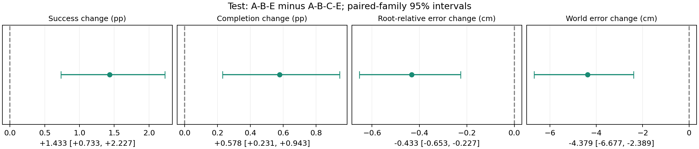
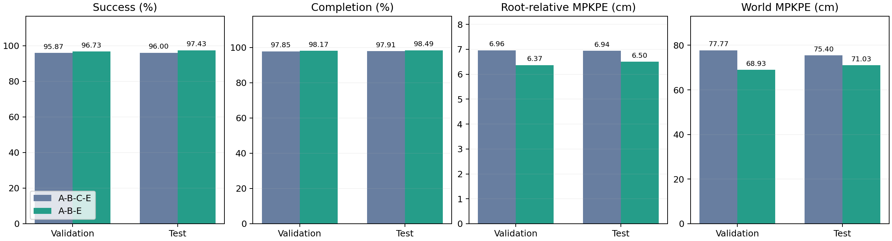
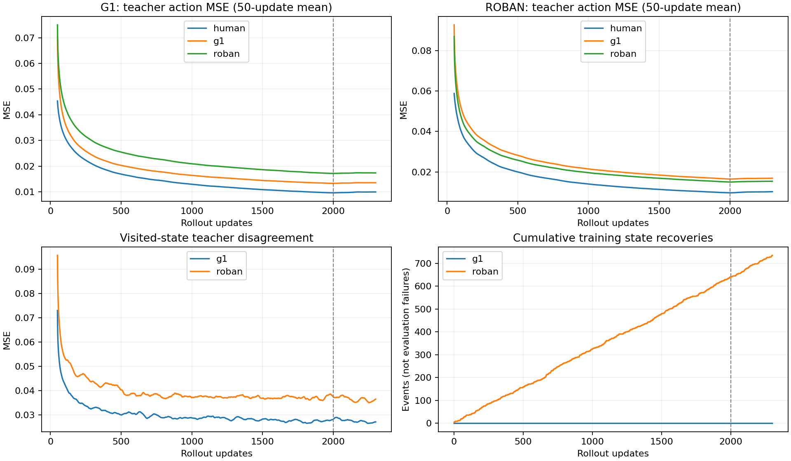

# 去除 C：固定第2300轮的完整评估结论

日期：2026-10-05 22:19（北京时间）。

比较同一 B 出发的 A→B→C→E 与 A→B→E。后者终点在训练前固定，验证和测试均完整覆盖500动作×六路，所有原始评分与权重身份审计通过。

## 主要判断

本次消融支持在当前数据、机型和预算下省略C：直接A→B→E在完整测试四项总体指标上优于原A→B→C→E，四项家族配对95%区间均支持改善。建议将A→B→E作为当前条件下的优先路线；原路线继续保留为对照。这个结论来自单个训练种子，不能扩展为“C在所有条件下无用或有害”。

测试成功组合从2880增加到2923（净增43）；逐动作配对为新增成功76、退化33、双方成功2847、双方失败44。根相对误差下降6.24%，世界误差下降5.81%。跑步成功750/792→772/792，走路1509/1578→1524/1578，上身621/630→627/630。

逐路取舍必须保留：测试G1→G1成功率下降0.4个百分点、完成比例下降0.2772个百分点；G1→Roban世界误差增加4.7575 cm（验证也增加4.6689 cm）。其余五路测试成功率提高，全部六路根相对误差降低。验证Roban→G1成功率下降1个百分点、完成比例下降0.9183个百分点。不能把总体改善表述为所有路径全面改善。

验证成功率及两类误差的总体区间支持改善；验证完成比例区间跨零，仅能报告点估计提高。测试两模型六路恢复片段均为0；验证两模型逐路恢复均为0/0/0/2/2/2。

## 总体结果

| 划分 | 路线 | 成功率 | 完成比例 | 根相对 MPKPE | 世界 MPKPE |
|---|---|---:|---:|---:|---:|
| 验证 | A→B→C→E | 95.8667% | 97.8549% | 6.9639 cm | 77.7682 cm |
| 验证 | A→B→E | 96.7333% | 98.1660% | 6.3680 cm | 68.9336 cm |
| 测试 | A→B→C→E | 96.0000% | 97.9144% | 6.9362 cm | 75.4041 cm |
| 测试 | A→B→E | 97.4333% | 98.4919% | 6.5034 cm | 71.0251 cm |

## 验证逐路结果

| 路径 | 成功率 原路线→去C | 完成比例 原路线→去C | 根相对误差 cm | 世界误差 cm | 恢复片段 |
|---|---:|---:|---:|---:|---:|
| human->g1 | 96.00→97.20% | 97.73→98.36% | 7.46→7.00 | 82.14→68.64 | 0→0 |
| g1->g1 | 95.80→98.40% | 97.68→98.84% | 6.82→6.48 | 70.30→61.39 | 0→0 |
| roban->g1 | 97.00→96.00% | 98.46→97.55% | 6.60→6.18 | 69.02→53.81 | 0→0 |
| human->roban | 95.00→95.60% | 97.44→97.94% | 7.85→6.60 | 92.52→80.50 | 2→2 |
| g1->roban | 95.00→96.20% | 97.42→97.86% | 6.40→6.04 | 74.87→79.54 | 2→2 |
| roban->roban | 96.40→97.00% | 98.40→98.45% | 6.65→5.91 | 77.76→69.73 | 2→2 |

家族配对95%区间（去C减原路线）：成功率[0.1389, 1.6414]个百分点；完成比例[-0.1493, 0.7796]个百分点。
根相对误差差值区间[-0.8259, -0.3594] cm。
世界误差差值区间[-15.1938, -3.6950] cm。

## 测试逐路结果

| 路径 | 成功率 原路线→去C | 完成比例 原路线→去C | 根相对误差 cm | 世界误差 cm | 恢复片段 |
|---|---:|---:|---:|---:|---:|
| human->g1 | 95.20→97.20% | 97.46→98.30% | 7.59→6.95 | 71.84→65.20 | 0→0 |
| g1->g1 | 97.20→96.80% | 98.32→98.05% | 6.93→6.52 | 67.89→64.17 | 0→0 |
| roban->g1 | 96.20→97.60% | 97.94→98.64% | 6.68→6.52 | 63.70→59.55 | 0→0 |
| human->roban | 94.80→96.40% | 97.53→98.10% | 7.65→6.99 | 90.47→81.67 | 0→0 |
| g1->roban | 95.60→98.20% | 97.85→98.80% | 6.52→6.20 | 79.11→83.87 | 0→0 |
| roban->roban | 97.00→98.40% | 98.38→99.06% | 6.25→5.84 | 79.42→71.68 | 0→0 |

家族配对95%区间（去C减原路线）：成功率[0.7326, 2.2266]个百分点；完成比例[0.2308, 0.9426]个百分点。
根相对误差差值区间[-0.6529, -0.2268] cm。
世界误差差值区间[-6.6770, -2.3892] cm。

## 训练与公平性

训练完成2300轮，75,366,400 transitions、68,800次优化、271,974,400次回放状态抽样，均与原C＋E一致。耗时6983.48秒（约1小时56分）。六路训练Teacher MSE均下降；G1/Roban训练累计状态恢复为0/735，不能将该计数等同于评估失败率。

全程学习率1e-5，训练所有actor来源与执行模块，保持目标为冻结B同来源动作、系数0.1。原路线E保持目标为冻结C。两路线可训练模块、监督来源和教师查询数量不同，本实验不是等FLOPs或严格单损失因素消融。

验证保持64环境，测试保持500环境，seed42；与原路线对应划分环境JSON逐值一致。并行调度只改变执行时间，保留原验证进程，参数与终点不变。

区间来自一个训练种子的动作家族配对bootstrap（10000次）；不能推断多种子训练方差。测试集在先前研究中已被查看，本轮固定终点且未按测试挑选模型，不宣称新的未触碰留出集。没有预先规定非劣界值，区间跨零不能解释为已证明等效。

## 可复查产物

- [固定终点权重](../../logs/v0.2/no_c_ablation_20261005/direct_e_run01/checkpoint_2300.pt)
- [验证配对比较](../../logs/v0.2/no_c_ablation_20261005/direct_e_run01/comparison_val.json)
- [测试配对比较](../../logs/v0.2/no_c_ablation_20261005/direct_e_run01/comparison_test.json)
- [最终评分审计](../../logs/v0.2/no_c_ablation_20261005/direct_e_run01/final_evaluation_audit.json)
- [实际终点训练审计](../../logs/v0.2/no_c_ablation_20261005/direct_e_run01/checkpoint_2300.audit.json)
- [实验方案及启动记录](10_去除C阶段消融实验.md)

终点权重SHA256：`e87d0cc56789885e64ffe64c753f947c3549bec5759695637065973171e4fa02`。

完整数据家族互斥和环境/模型/数据代码一致性核验见[数据与代码审计](../../logs/v0.2/no_c_ablation_20261005/direct_e_run01/data_code_audit.json)。分析代码归档摘要见[分析出处](../../logs/v0.2/no_c_ablation_20261005/analysis_provenance.json)。测试摘要gate中的full_validation_required仅表示测试集不适用验证准入门槛，性能结论来自同测试集配对比较及原始评分审计。
