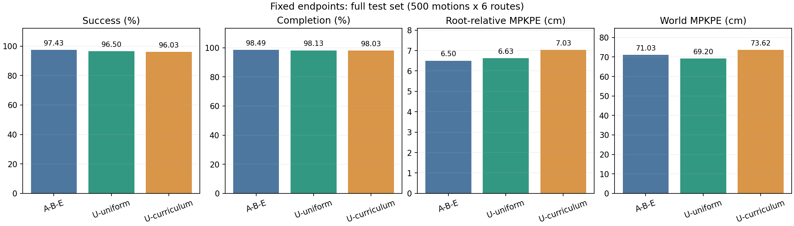
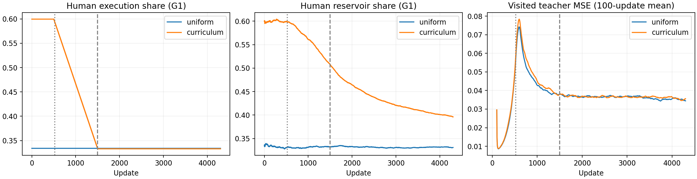

# 阶段 U：完整验证、测试与路线判断

日期：2026-10-06 12:12（北京时间）。

两组U各完成4300轮；完整验证与测试各500动作×六路。固定终点、训练预算、随机初始模型、教师身份、原始评分和六份配对统计复算通过。

## 主要结论

**当前最佳路线仍为A→B→E。** U-uniform与U-curriculum都能从随机学生学成六路控制，但本次配方均未达到原路线的成功率。Human偏置rollout课程未带来额外收益，不应以简化阶段数量为由替换已有最佳模型。

这证明独立B不是“学成控制”的绝对必要条件，但尚未证明在相同预算下可以无损替代。两种U与A→B→E的学习率、保持项和训练参数安排存在差异；U之间才只有来源课程不同。本轮单训练种子，不能据此断言所有联合方法或所有课程都无效。

## 六路总体结果

| 划分 | 路线 | 成功率 | 完成比例 | 根相对MPKPE | 世界MPKPE |
|---|---|---:|---:|---:|---:|
| 验证 | A-B-E | 96.7333% | 98.1660% | 6.3680 cm | 68.9336 cm |
| 验证 | U-uniform | 95.9667% | 97.9746% | 6.7276 cm | 70.4371 cm |
| 验证 | U-curriculum | 95.5667% | 97.7760% | 6.7849 cm | 72.5160 cm |
| 测试 | A-B-E | 97.4333% | 98.4919% | 6.5034 cm | 71.0251 cm |
| 测试 | U-uniform | 96.5000% | 98.1308% | 6.6252 cm | 69.2000 cm |
| 测试 | U-curriculum | 96.0333% | 98.0327% | 7.0311 cm | 73.6246 cm |

## 统计证据与逐路取舍

测试成功组合A→B→E为2923/3000，U-uniform为2895/3000（少28），U-curriculum为2881/3000（少42）。

相对A→B→E，uniform测试成功率差-0.9333个百分点，家族配对95%区间[-1.7112,-0.2155]；curriculum差-1.4000个百分点，区间[-2.3099,-0.5703]。两组验证成功率区间也均支持下降。

uniform测试世界误差点估计更低，但差值区间约[-3.6027,+0.0196] cm，跨零；不能宣称该项优势已明确。uniform测试完成比例及根相对误差区间也跨零。curriculum相对A→B→E的测试完成比例下降、根相对误差增加均获区间支持，世界误差区间跨零。

curriculum减uniform：测试成功率差-0.4667个百分点，区间[-1.3566,+0.3381]，不能确定成功率差异；根相对误差差区间[+0.0630,+0.8897] cm、世界误差差区间[+0.1312,+10.3783] cm，支持课程组精度较差。验证中两U组四项差值区间均跨零。以上区间仅刻画当前训练种子的动作家族抽样不确定性。

| 测试路径 | A→B→E成功率 | U-uniform | U-curriculum |
|---|---:|---:|---:|
| human->g1 | 97.2% | 97.2% | 96.2% |
| g1->g1 | 96.8% | 97.0% | 96.2% |
| roban->g1 | 97.6% | 95.8% | 96.2% |
| human->roban | 96.4% | 95.0% | 94.6% |
| g1->roban | 98.2% | 97.4% | 96.6% |
| roban->roban | 98.4% | 96.6% | 96.4% |

uniform测试退化较集中于Roban来源的两条路径（均-1.8个百分点）；两条路径的成功率差区间均低于零。curriculum测试六路成功率点估计均低于A→B→E。三模型测试恢复片段均为0；验证恢复片段按Human/G1/Roban→G1、Human/G1/Roban→Roban顺序，原路线与curriculum为0/0/0/2/2/2，uniform为0/0/0/2/1/2。

## 课程是否按预设执行

检查实际日志：curriculum初始Human执行比例约59.96%；第1500轮约33.31%，之后维持均衡。Teacher接管从第521轮起为0，两组都符合预设。课程确实作用于rollout，六路监督损失始终等权。

reservoir存在预期的全历史保留效应：第1500轮Human状态来源占比仍约50.7%/50.8%（G1/Roban）；第4300轮仍约39.6%/39.2%。因此结束时“rollout均衡”不等于“回放状态来源均衡”。这不是课程未执行，但意味着早期状态分布偏置持续进入后期训练。它是后续可消融的解释，不能仅凭相关性认定它造成性能下降。

训练前100轮大量Teacher接管，后100轮纯学生执行，因此visited_teacher_mse的前后均值不是同分布比较，不能用其上升直接宣告训练发散。训练累计G1/Roban恢复为uniform 0/1386、curriculum 0/1362，训练计数与正式评分中的恢复片段分开解释。

## 预算与结论范围

每组140,902,400 transitions、132,800次优化、534,118,400次回放状态抽样，对齐原B＋E这些计数。两组初始参数完全相同，解析配置仅source_sampling不同，actor外参数冻结。uniform/curriculum训练耗时约4.65/4.67小时，因并行共享GPU，不据此比较单任务计算效率。

验证保持64环境，测试500环境，seed42。六路和全部失败片段保留；误差按每路有效步数加权后六路等权平均。测试集已被先前研究查看，本轮终点在训练前固定且没有根据测试换模；不声称新的未触碰留出集。未评估中间checkpoint以事后挑选最佳结果。

## 下一步建议

继续保留A→B→E为主路线。如果继续探索U，优先做一个明确对照：保持uniform与curriculum其余条件不变，用来源分层/可控状态抽样检验全历史reservoir对课程效果的影响；若改变回放机制，两组都应有对应对照。另一项不同问题是Human监督权重课程，它需要单独登记，不能把本次rollout课程的负结果推广到损失权重课程。多种子重复可验证当前差异的训练稳定性。以上仅为建议，本轮未启动新实验。

## 产物

- [最终复核审计](../../logs/v0.2/unified_20261006/final_review_audit.json)
- [uniform测试比较](../../logs/v0.2/unified_20261006/uniform/comparison_test.json)
- [curriculum测试比较](../../logs/v0.2/unified_20261006/curriculum/comparison_test.json)
- [两U组测试直接比较](../../logs/v0.2/unified_20261006/curriculum_vs_uniform_test.json)
- [uniform固定终点权重](../../logs/v0.2/unified_20261006/uniform/checkpoint_4300.pt)
- [curriculum固定终点权重](../../logs/v0.2/unified_20261006/curriculum/checkpoint_4300.pt)
- [实验设计与启动记录](12_U阶段联合训练实验.md)
