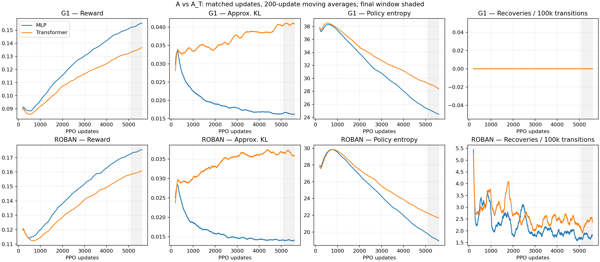

# A_T与MLP教师同期训练比较：第5600轮

统计时间：2026-10-06T21:53:56.277520+08:00（北京时间）。只读分析训练记录，未暂停训练、修改超参数或启动额外仿真。

## 结论

当前相同采样预算下，Transformer教师的训练奖励落后于MLP，KL与熵更高；曲线仍持续改善，没有看到数值发散证据。尚不能由随机策略训练奖励直接判断最终确定性策略的完整验证成功率，也不能推广到尚未开始的B_T/E_T学生。

## 比较口径

统一截止第5600轮，每教师734,003,200 transitions、268,800次PPO优化。表格采用第5101–5600轮500轮均值，曲线采用200轮滑动平均。指标来自metrics.jsonl，与TensorBoard使用同一log_metrics写入，避免网页平滑系数不同造成误读。

两路线每机型4096环境、rollout32步、3 epochs、minibatch8192、学习率1e-4、clip0.2、entropy_weight0.005、value_weight0.5、seed0、数据/时序上下文/梯度裁剪相同；环境JSON逐值一致。网络结构与参数量不同，实际轨迹也随策略不同。未把MLP最终10000轮与当前Transformer作比较。

| 指标（最近500轮） | G1 MLP | G1 Transformer | Roban MLP | Roban Transformer |
|---|---:|---:|---:|---:|
| 平均奖励 | 0.154270 | 0.135552 | 0.174663 | 0.160004 |
| Policy loss | -0.012965 | -0.023749 | -0.009580 | -0.022983 |
| Value loss | 0.083724 | 0.078518 | 0.108201 | 0.107396 |
| Approx. KL | 0.016353 | 0.040841 | 0.014156 | 0.036480 |
| 策略熵 | 24.705249 | 28.691318 | 19.166528 | 21.828325 |
| 裁剪前梯度范数 | 1.998947 | 2.075597 | 2.465992 | 2.464785 |
| Done fraction | 0.005351 | 0.005388 | 0.005363 | 0.005409 |
| Recovery fraction | 0.000000 | 0.000000 | 0.000018 | 0.000024 |
| 窗口新增恢复事件 | 0 | 0 | 1183 | 1553 |
| 累计恢复事件 | 0 | 0 | 16851 | 20059 |

## 解读

1. G1奖励0.154270→0.135552（约-12.1%）；Roban 0.174663→0.160004（约-8.4%）。500轮窗口在1000、3000、5000轮的比较也呈落后，差距并非单轮噪声。两种结构奖励均继续上升，不能解释为已经完全不再学习。

2. G1 KL约2.50倍、Roban约2.58倍。相同学习率与PPO clip并不意味着策略更新幅度相同；目前Transformer的行为分布变化更大。但这是近似KL，不是clip fraction，也没有预设据此自动提前停止的阈值。不能仅凭这一项宣称训练崩溃。

3. Transformer策略熵G1高约16.1%、Roban高约13.9%，提示随机策略保持更大的探索噪声。训练奖励受该噪声影响，最终动作均值策略可能有不同表现，须按既定完整验证评价。不同机器人动作维数不同，熵不在G1与Roban之间直接比较。

4. Transformer policy loss更负，不代表控制能力更好；PPO surrogate受旧策略、优势和当前采样分布影响。Value loss G1较低、Roban近似，但也不能直接说明actor更好，因为双方回报分布不同。梯度范数是clip_grad_norm_返回的裁剪前范数，数值大于max_grad_norm=1不表示裁剪失效。

5. G1双方恢复事件为0。Roban窗口新增恢复1183→1553（+31.3%）；累计16851→20059（+19.0%）。窗口约为每10万transitions 1.81→2.37次。原始恢复计数、recovery_fraction与验证恢复片段含义不同，不能替代完整动作失败率。Done fraction同时包含完成与其他终止，不能等同摔倒率。

6. 第5600轮累计墙钟，G1 MLP约9.93h、Transformer约7.75h；Roban约9.86h、7.91h。仅是两次实际运行观测：历史GPU并发/负载、不同参数量等未受控，不能当作严格架构加速比，更不能外推G1本机ONNX的50Hz时延。

## 对当前实验的建议

继续按原10000轮预算运行，不在中途依据这些指标修改学习率或熵系数，以保留原先固定超参数的架构对照。完整验证后再决定是否有必要另开Transformer专属超参数实验。若需要定位KL偏高，后续可单独研究学习率/目标KL控制；若研究探索噪声，则另做熵系数对照，不把这些改变混进本轮。

## 可复查产物

- [窗口统计与可比性核验](analysis/transformer_20261006/analysis_5600/comparison.json)
- [生成脚本](analysis/transformer_20261006/analysis_5600/compare_training.py)
- 该目录保留四份截止5600轮的指标快照，后续训练继续写入不改变本报告输入。
